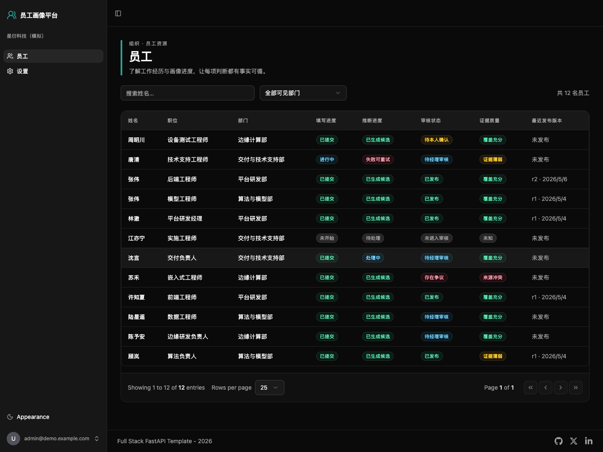
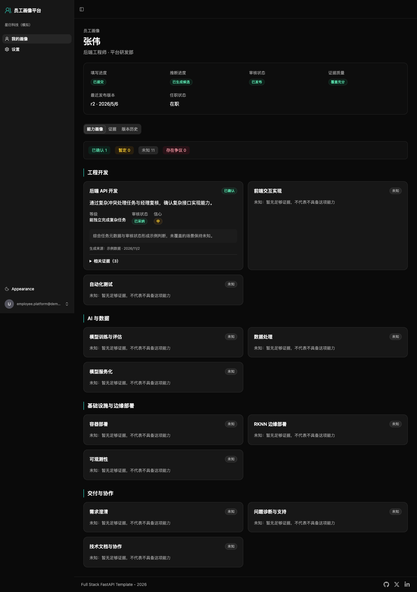
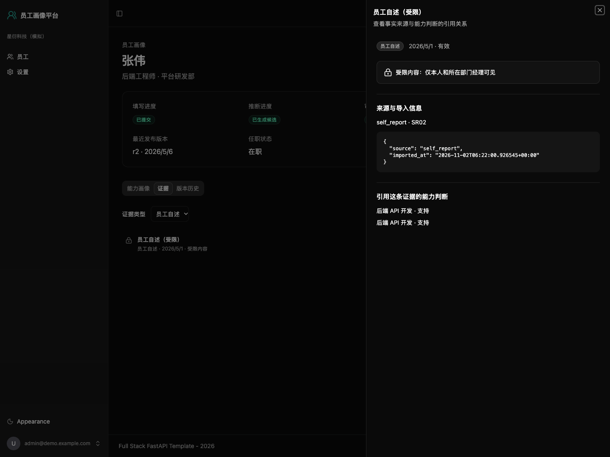
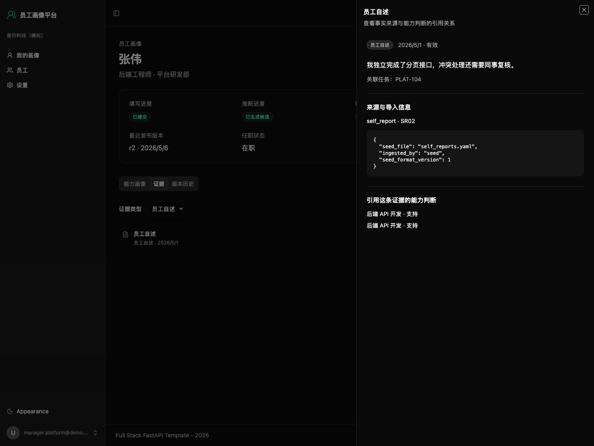
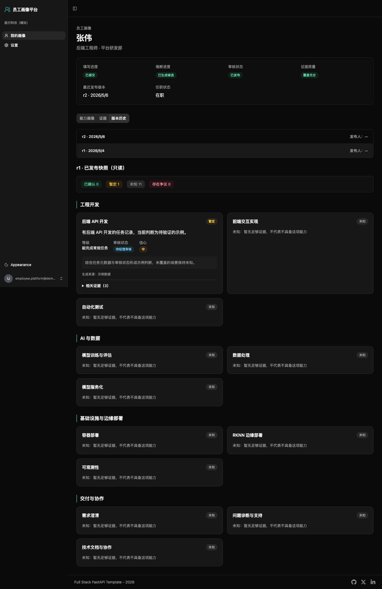

# 企业员工画像与跨部门协同平台

开源、可自托管的员工资源画像平台，让跨部门协同基于可信能力与事实。

Phase 1 回答四个问题：**这个人做过什么、能承担哪些工作、证据是什么、哪里还需要确认**。能力判断关联证据，区分已确认、暂定、未知和存在争议；缺少记录不代表不会，信心标签不是概率。不打绩效分、不自动排班、不默认采集私人资料。

基于 Full Stack FastAPI Template，使用 FastAPI、React、PostgreSQL 和 Docker Compose。当前 M1 支持一次部署、网页初始化、全量名单导入、账号发放与角色管理；尚未接入模型或真实 Jira。

## 生产安装

准备 Git、curl、Docker 和 Docker Compose 2.24.4+，在全新目录运行：

```bash
git clone https://github.com/ft1148137/employee-profile-platform.git
cd employee-profile-platform
./install.sh
```

按提示填写服务器 IP 或域名、访问方式和端口。安装器生成随机密钥、启动生产服务并打印一次性初始化链接，**不导入演示数据**。把链接单独交给企业管理员，用网页完成建企业、导入名单、选择词典、下载员工账号。

- [部署与维护指南](docs/deploy.md)：访问方式、备份恢复、升级回退、管理员密码重置。
- [企业管理员指南](docs/admin-guide.md)：带截图的向导、名单维护、账号和角色管理。
- [M1 验收记录](docs/m1-acceptance.md)：本机实测范围与限制。

## 本机演示

仅在另一个全新克隆目录复制演示配置，8000 端口需空闲：

```bash
cp .env.example .env
docker compose up -d --wait
```

打开 <http://localhost:8000>。此方式有固定测试密码和开发接口，只供本机合成数据演示。已有部署不要覆盖 `.env`。

也可在独立目录运行 `EPP_HTTP_PORT=18080 COMPOSE_PROJECT_NAME=epp-demo ./install.sh --demo --non-interactive`，由安装器生成随机演示密码；下表前四个身份不变，密码以安装器打印值为准；这种方式不创建平台超管，`superadmin` 仅由下面的 `.env.example` 演示配置提供。

## 演示账号

前四个账号密码均为 **`demo-password-2026`**，来自 `.env.example` 的 `DEMO_USER_PASSWORD`。账号和样例以 [示例数据说明](examples/demo-org/README.md) 为准，所有公司、员工和证据均为虚构。

| 登录名 | 身份 | 登录后可见内容 |
| --- | --- | --- |
| `admin` | 企业管理员 | 全部 12 名员工及画像；自述和经理评价显示为受限，不能读正文 |
| `E01` | 平台研发部经理，E01 林澈 | 平台研发部 3 名员工及其自述、经理评价 |
| `E02` | 员工 E02 张伟 | 仅本人画像；有两个已发布版本，可对比历史 |
| `E05` | 员工 E05 张伟 | 仅本人画像；与 E02 同名，但身份独立 |
| `superadmin` | 平台超管，同时获授演示组织企业管理员 | 平台账号管理和演示组织全部画像；受限证据仍不能读正文 |

也可以用账号邮箱登录，工号与邮箱均忽略大小写。最后一个账号的登录名由 `FIRST_SUPERUSER_USERNAME` 配置（默认 `superadmin`），邮箱和密码使用 `FIRST_SUPERUSER` / `FIRST_SUPERUSER_PASSWORD`，默认密码 **`changethis`**。平台超管本身不绕过组织权限，演示初始化显式授予了企业管理员角色。更改 `.env` 不会修改已导入账号的密码。

## 你会看到什么

管理员和经理先进入员工列表，可按部门筛选、按姓名搜索，查看填写、推断、审核和证据质量四个进度维度；员工直接进入本人画像。



画像按能力词典逐项展示判断及依据；没有判断的能力明确显示未知。点击展开的证据可打开抽屉查看来源与导入信息。



同一份自述，管理员看到受限提示，所在部门经理和员工本人可查看内容：





在「版本历史」选择 E02 的 r1、r2，可读取当时冻结的判断快照；历史不会覆盖当前画像。



## 停止与重置

在仓库根目录执行，停止服务并保留数据库：

```bash
docker compose down
```

**警告：下面的命令会删除此 Compose 项目的数据库卷，包括你保存的数据。** 仅用于重置本机演示，下次启动会重新导入示例数据：

```bash
docker compose down -v
```

已启动的演示栈可用冒烟测试检查服务、画像完整性及角色隔离（额外需要 bash、curl、python3 和 docker compose）：

```bash
bash tests/smoke/compose_smoke.sh
```

默认检查 `http://localhost:8000`；可通过 `BASE_URL` 指定入口。密码优先取环境变量 `DEMO_USER_PASSWORD`，否则读取仓库根目录 `.env`；脚本沿用调用方的 `COMPOSE_PROJECT_NAME`。同一台机器运行多个克隆时，请给各自设置不同项目名和 `API_PORT`，避免资源或端口冲突。

## 安全与部署

默认配置仅供本机演示：包含默认密钥，启用 `FASTAPI_ENV=development`，Web/API 只绑定 `127.0.0.1:8000`，数据库不发布宿主机端口。开发模式提供开发专用接口，不能直接用于对外服务。

对外部署前按 [部署指南](docs/deploy.md) 在全新目录安装生产环境、配置 HTTPS。`.env` 只保存在本地，不提交凭据或真实员工资料。

## 项目状态与路线图

| 里程碑 | 范围 | 状态 |
| --- | --- | --- |
| M0 底座与演示 | 租户权限、示例数据、只读画像、Compose | 已实现 |
| M1 一次部署与企业初始化 | 安装、网页向导、名单、账号、角色、审计 | 本 README 的验收范围 |
| M2 外部数据与初始画像 | 来源同步、初始画像请求 | 后续里程碑 |
| M3 画像助手与员工更新请求 | 对话、预览、本人确认 | 后续里程碑 |
| M4 经理审批与持续更新 | 批准发布、增量更新 | 后续里程碑 |
| M5 按能力找人与开源发布 | 检索、安全与许可证核验 | 后续里程碑 |

不承诺日期，每个里程碑后按真实使用反馈决定下一步。跨部门调配 P1–P6 当前只在架构文档说明扩展位置，不实现调配逻辑。

- [文档索引](docs/README.md) / [开发指南](docs/development.md)
- [架构与核心对象](docs/architecture.md) / [架构决策记录](docs/adr/README.md)
- [能力词典模板](templates/README.md) / [示例数据](examples/demo-org/README.md)
- [后端](backend/README.md) / [前端](frontend/README.md) / [部署](deploy/README.md)

当前沿用模板的 [MIT 许可证](LICENSE) 并保留其版权声明，正式发布前确定项目许可证并逐项核验依赖。
