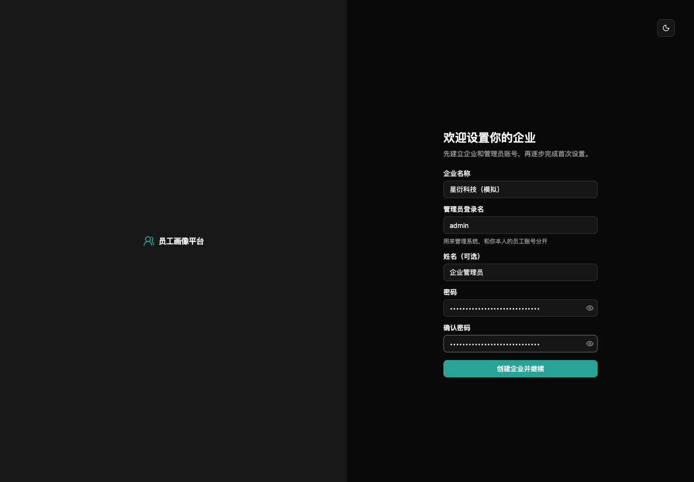
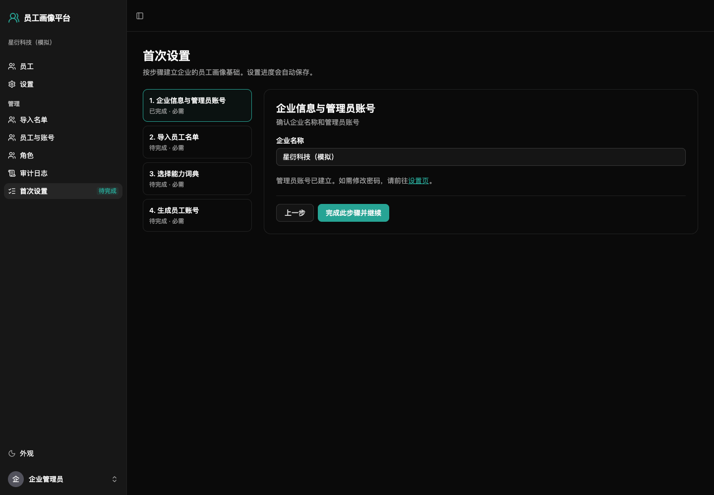
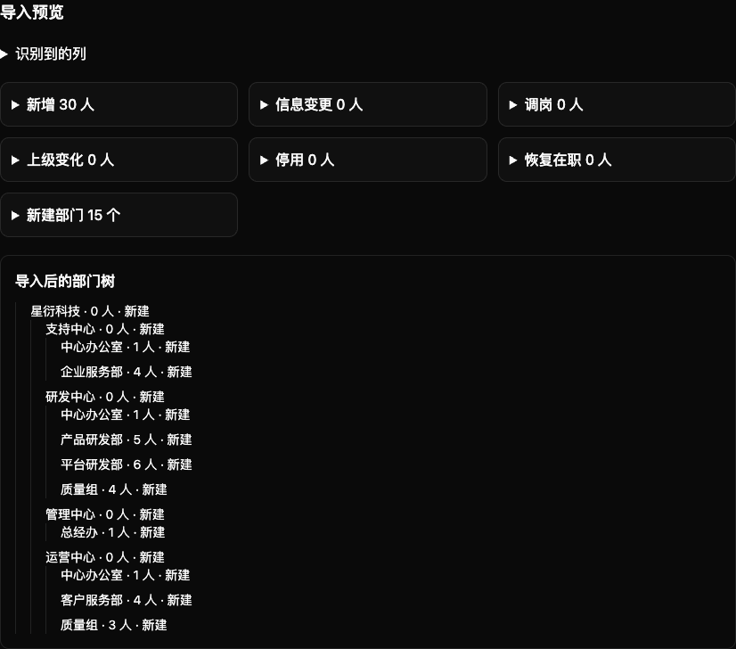
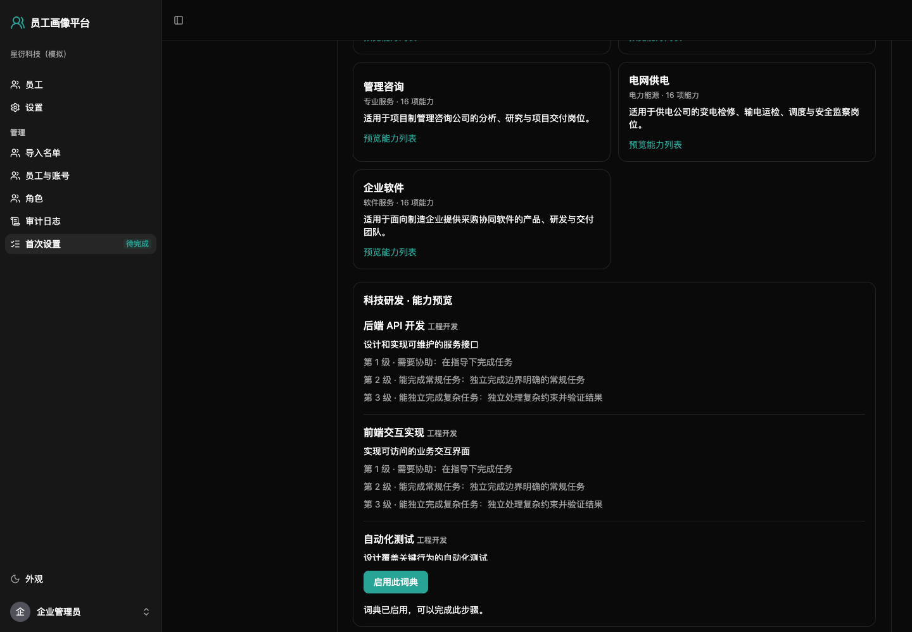
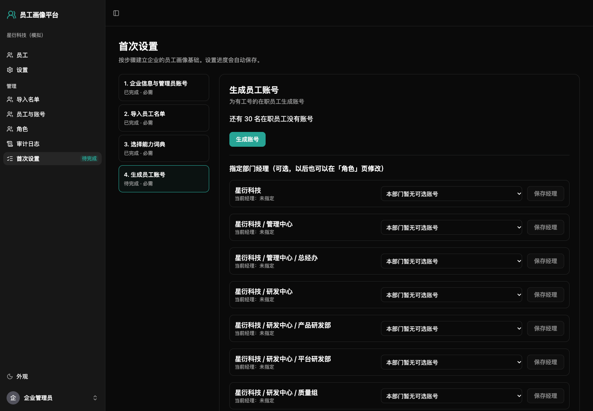
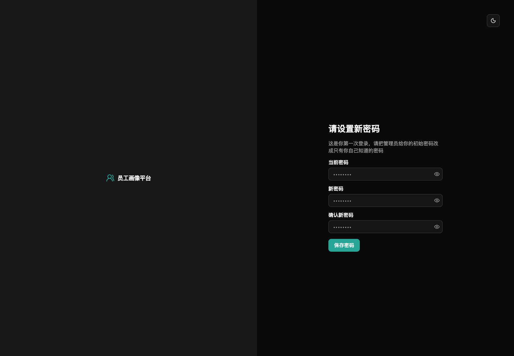
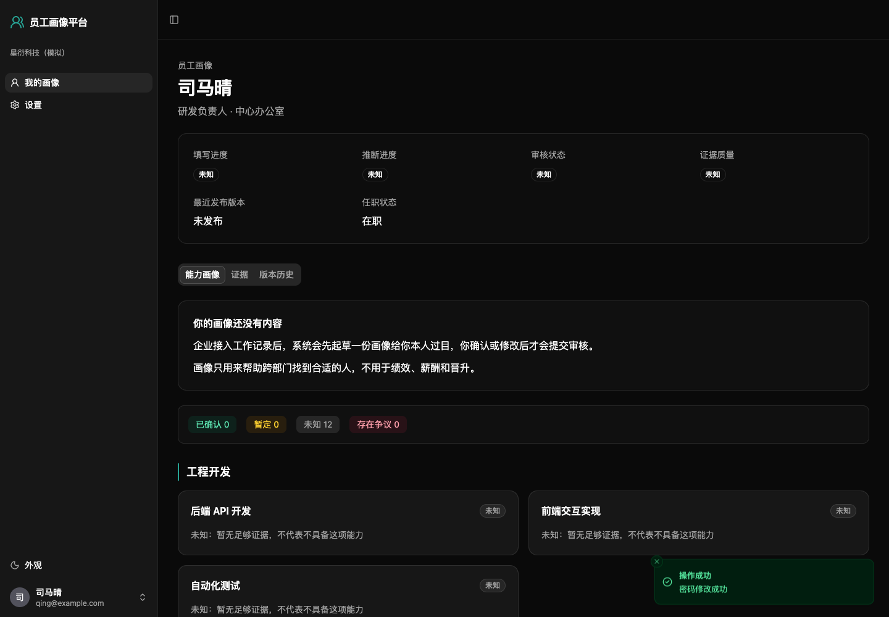
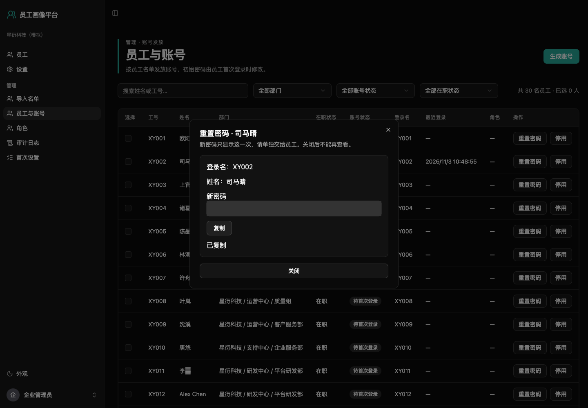

# 企业管理员使用指南

M3 的四种员工更新入口见[员工指南](employee-guide.md)，验收与复现见[M3 验收](m3-acceptance.md)。员工登录名是名单中的邮箱，工号仅用于关联员工；缺少邮箱的行必须在预览阶段补齐。

## 外部助手和内置机器人

「管理 → 外部 AI 助手」（`/admin/assistants`）默认关闭 MCP。启用前阅读证据和自述会发给外部 AI 厂商的提示，可设置客户端允许列表；名称由客户端声明，不能当作身份认证。员工分别授权 OAuth 或创建个人令牌，管理员不能代替员工提交或批准请求。

「管理 → 内置机器人」（`/admin/bot`）可编辑提问指南、聊天原文保留天数（默认不保留，最多 30 天）。确认过的自述另存为受限证据。每名员工每小时最多 30 轮，起草任务优先；只有一个 ChatGPT 订阅时，全企业对话与起草共用额度。机器人没有模型时会引导员工用表单。

部署人员会交给你一个初始化链接。准备好企业的**全量在职员工名单**和要使用的能力词典，后续操作都在网页里完成，不需要修改服务器文件。本文截图使用虚构的星衍科技，页面中的人数和姓名仅供示范。

## 第一次建立企业

打开部署人员给你的完整链接，填写企业名称、管理员邮箱、姓名（可空）和两次密码，再点「创建企业并继续」。请记住管理员邮箱和密码。这个账号用于管理系统，可以不在员工名单中，邮箱就是登录名。链接只能用一次，过期请联系部署人员。

创建后进入「首次设置」（`/setup-wizard`）。四步进度自动保存，退出后可以继续。

### 1. 企业信息与管理员账号

核对企业名称。管理员账号在打开链接建企业时已经建立；修改密码可去「设置」页。确认后点「完成此步骤并继续」。

### 2. 导入员工名单

点「下载模板（Excel）」或「下载模板（CSV）」。保留以下 6 个列名，一人一行：

| 列名 | 怎么填 |
| --- | --- |
| 工号 | 必填，不重复，按文本填写，例如 `XY002`、`0012`。不要让 Excel 去掉开头的 0。它仅是员工编号，后续不要随意改号 |
| 姓名 | 必填，可以同名，以工号区分 |
| 部门 | 必填，层级用 `/`，例如 `研发中心/平台研发部`；不要多加空层级。同一上级下部门名不能重复，不同上级下可以同名 |
| 职位 | 可以空，填写当前职位 |
| 上级工号 | 可以空；填同一份名单里的直属上级工号，不能是自己，也不能循环汇报。这里只记录一名直属上级，不自动授权部门经理 |
| 邮箱 | 必填；必须是有效且不重复的完整邮箱，邮箱就是登录名。缺失、格式不正确或与本部署其他账号冲突会阻断导入，并标出行号 |

只支持 `.xlsx`、`.csv`，不支持旧版 `.xls`。文件最多 5 MB、5000 人。中文 CSV 支持 UTF-8（可带 BOM）和 GB18030；公式请先计算保存，或粘贴为值。

选择文件，先看「导入预览」：逐项核对新增、调岗、上级变化、停用、恢复在职的人数和部门树。有错误就改好文件再上传；确认无误才点「确认导入」。成功后点「完成此步骤并继续」。截图的预览支持展开查看变更人员。

**每次都上传全量在职名单**。没有出现在文件里的在职员工会被停用，画像和证据保留。超过 20% 的在职员工将被停用时需要额外勾选确认；看到大量停用先检查是否误传了单个部门名单。预览过期表示期间有人导入过另一份名单，请重新上传。

### 3. 选择能力词典

选择适合行业的模板，在预览里查看能力项目和三级标准，再点「启用此词典」，最后完成这一步。科技研发为推荐模板，另外有 10 个行业模板。模板作为起点；后续可在「设置 → 能力词典」上传文件或在网页上编辑，即使已有画像判断也可以保存新版本。

### 4. 生成员工账号

页面显示还有多少在职员工没有账号。点「生成账号」核对范围，再点「确认生成并下载」，浏览器会下载 Excel 账号文件。确认文件已保存并能打开，然后关闭弹窗、完成这一步。浏览器拦截下载时先允许本网站下载。

账号文件含登录名（邮箱）、姓名、部门、登录地址、初始密码和备注。「部门」写完整路径，例如「研发中心/质量组」。**初始密码只导出这一次**。只把对应一行的登录地址、邮箱和密码单独发给本人，不要把整份文件发到群里。确认交付后按企业规定安全删除或保管文件。

丢失文件时，在「管理 → 员工与账号」选择待首次登录的人，勾选重新生成初始密码；旧文件里的密码会失效。已经改过密码的人用「重置密码」。

同一步可以按部门「保存经理」。此操作只增加授权，不会替换已有经理。换经理前先到「管理 → 角色」撤销原经理的对应授权，再保存新经理。汇报关系与部门经理查看权限分别管理。

## 员工第一次登录

员工打开账号文件中的登录地址，用邮箱和初始密码登录，系统会要求输入当前密码、新密码、确认新密码。保存成功后进入本人画像。刚建好企业时出现「你的画像还没有内容」是正常现象，缺少记录不代表不会。

邮箱登录会忽略首尾空格和大小写，工号不能用来登录。没有公开注册入口；新员工先由管理员导入名单，再生成账号。

## 新增、调岗与离职

去「管理 → 导入名单」（`/admin/roster`），下载最新模板或更新自己保存的全量名单：新增员工加一行，调岗修改部门或职位，上级变化修改上级工号，离职从全量在职名单移除。重新上传，检查预览后确认，导入历史可查看操作结果。

旧账号缺少邮箱或有冲突时保留原登录名，账号页显示「缺少邮箱，补上后改为邮箱登录」。在名单里补上未被占用的邮箱并重新导入，账号邮箱和登录名会一起更新，并记录审计；已有密码不变。修改邮箱也按此规则处理。

系统按工号匹配同一个人。改工号会被视为旧人离职加新人，不是改名。重新加入已停用工号会恢复在职状态，但已有账号仍需去「员工与账号」核对并启用；不会删除既有画像与证据。新员工导入后还需生成账号。

## 员工忘记密码或需要暂停登录

去「管理 → 员工与账号」（`/admin/accounts`），可按姓名、工号、部门、在职状态或账号状态筛选。找到本人并核对工号，再点「重置密码」和「确认重置密码」。新密码只在这次弹窗出现，关闭后不能重看。

点「复制」后单独发给本人。若提示「请手动复制」，选中密码手动复制即可，不必再次重置。局域网 HTTP 中浏览器可能限制自动复制。重置会立即使原密码与旧登录失效，下次登录再次强制改密，也会解除该账号的登录失败限制。

失败 5 次后登录被限流，员工可稍后再试或请管理员重置。若全公司都遇到限制，请联系部署人员检查来源 IP 限制。你自己的管理员密码遗忘且没有其他管理员时，也要联系部署人员，员工账号无法替代管理员账号。

「停用」只暂停登录，保留画像和证据；「启用」恢复账号登录能力。账号启用不等于员工恢复在职，需要时先更新名单。

## 分配角色

「管理 → 角色」（`/admin/roles`）管理企业管理员和部门经理授权。企业管理员管理名单、账号、词典与角色，可查看企业员工画像；受限的自述和经理评价正文不会因此开放。部门经理可以查看获授权部门及其全部下级部门的员工，包括受限的自述和经理评价正文；普通员工只能看本人。

名单重新导入、部门调整后，经理的管辖范围在下一次请求时自动按当前部门结构生效。授权给上层部门意味着开放整棵子树，请按所需的最小范围授权。

直属上级工号不会自动变成角色授权。需要谁查看哪个部门，就明确授予对应部门经理角色。撤销前核对对象和部门，生产环境不能撤销最后一名有效企业管理员，先给接任者授权。

演示环境里的平台超管还拥有演示企业管理员授权，因此可能允许撤销 `admin`，不要照此判断生产环境是否还有管理员。

## 查看审计日志

「管理 → 审计日志」（`/admin/audit`）记录名单导入、发放账号、重置密码、停用启用、角色与设置操作。按时间和操作类型筛选，列表显示时间、操作人、操作、对象和摘要。日志不展示明文密码。发现不认识的操作，记下时间、操作者和事件，联系部署人员排查。

## 接入工作记录

在「数据来源」（`/admin/sources`）配置 Jira，先保存，再点「测试连接」「立即同步」。平台服务器接 Cloud 需能访问外网；接 Data Center 需能访问 Jira 所在内网。连接失败可先上传 CSV，不需要员工在服务器上操作。

| 类型 | 地址和凭据 |
| --- | --- |
| Jira Cloud | 站点地址、账号邮箱、API token。在 Atlassian 账号安全页创建 token，复制后填入网页；不要填账号密码。[官方创建说明](https://support.atlassian.com/atlassian-account/docs/manage-api-tokens-for-your-atlassian-account/) |
| Data Center / Server | 站点地址，优先用个人访问令牌（Jira 8.14 及以上，在个人资料页创建）；旧版用用户名和密码。[官方 PAT 说明](https://confluence.atlassian.com/enterprise/using-personal-access-tokens-1026032365.html) |

只同步编号、标题、类型、状态、指派人/报告人、创建/更新/解决时间、标签与组件；不抓评论、工时、附件和变更历史。「同步 description」默认关闭，打开后把 Cloud ADF 或 Server wiki 说明转为纯文本，说明可能包含企业敏感信息。首次默认最近 12 个月，可改起始日期；后续按更新时间增量同步，重叠窗口由系统去重。

工作记录可上传 CSV 或 Excel（最多 5 MB、20,000 行），模板在同页下载。中文列名或下列英文名均可；有错误整份不导入，按提示行号修正后重新上传。无时区的时间按北京时间解释并提醒；同一来源同一编号重复、缺必填列、无法识别时间都是常见错误。

| 列 | 填写规则 |
| --- | --- |
| `record_id`、`source`、`occurred_at`、`actor_account`、`title` | 必填：记录编号、来源名、发生时间、执行人账号、标题；时间建议 ISO 8601，带 `+08:00` |
| `actor_name`、`actor_role` | 执行人姓名和角色；姓名用于候选核对，账号才是来源内标识 |
| `participants` | 用分号分隔的 `账号:角色`，如 `synthetic.chen:评审人;synthetic.wang`；参与人也可生成证据 |
| `record_type`、`project`、`detail`、`status` | 可选：类型、项目、说明和状态 |

演示企业已有种子证据，不要再接模拟 Jira。想体验同步，另建企业，导入 `examples/test-enterprises/` 中的名单和工作记录；开发环境模拟 Cloud 地址如 `http://mock-jira:8080/qiguang-aiot`。

## 确认账号对应

「账号对应」（`/admin/identities`）列出来源账号。同步时，邮箱与本企业唯一在职员工一致（忽略大小写和首尾空白）的账号会自动关联，并标注「按邮箱自动关联」；审计记录为系统按邮箱匹配，关联后补出证据。名单导入确认后，新导入或补改邮箱的员工也会匹配已有的未关联账号。邮箱对应多名在职员工时不自动关联；Jira Cloud 隐藏邮箱的用户、没有邮箱的 CSV 账号仍留在「未关联」。姓名相同只给与唯一在职员工姓名完全相同的候选，标注「姓名相同，请核对」，由管理员确认；同名多人不合并，也可点「选择员工」手工对应。未关联账号的记录不算到任何人头上。解除关联会撤销由该账号得到的证据，保留原文与审计，并阻止之后的自动关联；管理员仍可手动重新关联并补出新证据。

从 Data Center 迁到 Cloud：在数据来源改类型、地址和新凭据，重新同步，再按候选确认新的账号。issue key 不变时记录和证据去重；Cloud 的 accountId 与旧 key 不同，需要重新确认。同一企业只接一个 Jira 站点，不能用这套流程合并两个编号会冲突的站点。

## 配置模型

「模型」（`/admin/model`）先选类型，再填模型名；保存配置不等于连接测试成功。密钥只写不读，留空保留原密钥，改提供方或地址时需重新填写。起草必须启用 AI 模型；关闭模型后不再排队起草，已排队任务中剩余员工会显示「模型已关闭」，重新启用后可重试失败的员工。也可以让员工用 JSON 导入画像（导入入口将在 M3 后续子任务提供）。无记录能力仍是未知。

| 类型 | 配置示例 |
| --- | --- |
| 云端 API | 选择 OpenAI、Anthropic、DeepSeek、通义千问、Kimi（国际/中国/Coding）或 OpenRouter；填写模型 ID（如 `gpt-4o-mini`）和 API key。目录内提供方地址固定；通义千问选择百炼区域 |
| 本地模型 | 选择本地模型，填写 Ollama 模型 ID（如 `qwen3`）、服务器可访问的 base URL（如 `http://ollama:11434`），按服务要求填写密钥 |
| 通用 OpenAI 兼容接口 | 部署模型 ID（不加 `openai/`）、兼容接口的 base URL（通常含 `/v1`）、该接口密钥 |
| ChatGPT 订阅 | 如 `chatgpt/gpt-5.4`、推理强度；不填 base URL 或 API key，按下文连接 |

推理强度可选 `off/minimal/low/medium/high/xhigh`。目录模型不支持的档位会在保存时报错；自定义服务由管理员确认支持，保存后务必测试连接。Pi 服务不可用时无法保存启用的配置，请稍后重试。升级时不能识别的旧模型会关闭，页面提示「请重新选择提供方」，原密钥保留。

发送给模型的是能力词典和最多最近 80 条 standard 工作记录的类型、标题、状态、标签、组件、项目、日期、角色及截断说明，不主动发送姓名、工号、邮箱、外部账号、部门或 restricted 自述。标题/说明本身仍可能包含身份或业务秘密，接入前应核对企业的数据外发要求。所有模型输入经白名单、输出经格式校验，但建议仍需本人核对，不能直接发布画像。

本平台不支持 Claude 订阅登录。按项目 D5，Claude 使用 Anthropic API key，订阅 OAuth 不用于本平台的第三方调用，参阅 [Anthropic 条款说明](https://code.claude.com/docs/en/legal-and-compliance) 和 [消费者条款](https://www.anthropic.com/legal/consumer-terms)。

ChatGPT：在本平台点「连接 ChatGPT」，打开授权链接并登录，将浏览器最后跳转的完整网址（包含 code 和 state）粘贴回来，点「完成连接」，显示已连接后再启用并保存。浏览器无法打开 localhost 回调页面是正常现象，复制地址栏网址即可。授权链接 15 分钟有效，只能由发起的管理员使用一次；可点「取消连接」重新开始。断开后请到 ChatGPT 安全设置退出相关会话。它通过 Pi 的 Codex 后端使用订阅，服务限制可能变化。

遇到 5 小时或每周用量上限时起草会暂停，在进度页显示原因和预计恢复时间，之后自动续跑；取不到恢复时间时约 30 分钟重试，实际配额以账号页面为准。个人套餐请在 ChatGPT 数据控制中核对用于改进模型的数据选项；真实员工数据建议用 Business/Enterprise 或 API，并由企业确认数据政策。只配订阅时，全企业员工和内置机器人共用一个账号的额度。企业订阅令牌会在锁内自动刷新；刷新失效时需管理员重新连接。本机只读开发验证见[开发文档](development.md#本机-chatgpt-订阅测试)。

## 生成初始画像与进度

向导顺序为名单、词典、账号、接数据来源、确认账号对应、配置模型、生成初始画像；第 7 步「配置模型」为必需项，必须启用模型才能完成；升级后的企业若未启用模型，需要回向导补此步骤。第 9 步是必需项：为所有未退出自动起草的在职员工生成请求，无记录者改动项为空。员工登录会看到「待你过目：系统起草的初始画像」，可以打开证据；员工可编辑、预览、提交和撤回；经理审批与发布在 M4。

「同步与起草进度」（`/admin/progress`）分别展示同步记录、计数、失败原因和起草进度。「重试」从同步断点继续；「重试失败的」仅重跑失败员工；「重新起草全部」只覆盖还没过目的初始草稿。暂停续跑任务仍在队列时，不要重复点击生成。

「自动起草设置」（`/admin/drafting`）可排除敏感能力、关闭部门（包含全部下级部门）。员工在本人画像页可退出或重新开启，只有本人能改变自己的选择。三个开关只影响后续自动起草，不修改已有证据、正式判断或草稿；重新打开后需管理员再次发起起草。

解释开头的经验项数按明确编号引用合并，不按标题相似度猜测；同一事项分别在 Jira 和 PLM 写明对应编号时是 1 项经验、2 个来源。来源数是不同来源名数量，最近时间取支持证据的最晚发生时间。仅有指派/报告关系不代表实际完成，所有工作记录推断最多为「暂定」。

### Jira 定时同步

在「数据来源」选择同步周期（关闭、每月、每季度、每年），点击「保存」。默认关闭，随时可以「立即同步」。下次时间按最近成功同步完成时间（没有则按保存时间）增加一个日历周期，月末取目标月份最后一天；时间按服务器 UTC 计算，页面按浏览器本地时区显示。Worker 每小时检查一次，到期后只排一次增量同步；停机错过多个周期也只补一次，已有同步在运行则跳过并推进到未来周期。失败不改变后续计划，最近结果和下次同步时间在数据来源页查看。增量同步沿用成功水位及一天重叠窗口，平台会去重，避免漏掉边界更新。
## 自定义能力词典

在「设置 → 能力词典」下载 YAML 或 Excel 模板，填写后上传（不超过 2 MB）。YAML 使用能力列表，每项包含 `key`、`name`、`category`、`description`、`level_rubric.levels`；等级包含 `key`、`label`、`description`。Excel 每行填写一个等级，同一能力的 key、名称、分类、说明、AI 设置要一致。key 区分大小写，不能重复；等级 key 在同一能力内不能重复。错误会显示行号。

也可点「在网页上编辑」，按分类增删能力、修改名称与说明、增删等级和修改等级描述。新能力自动生成序号标识，保存前可以修改，保存后固定。每项能力的「不由 AI 推断」与自动起草设置同步，取消勾选可恢复推断。

先核对新增、修改和删除的 key，再点击「确认保存新版本」。预览会列出删除能力的已有判断数和待移除改动项数。每次保存版本号递增，旧判断及已发布版本保留；删除的能力在员工画像「已不在当前词典中的能力」单独显示。更换 key 等同删除旧能力、新建能力。

未提交请求会对应新词典，删除的能力项会移除并通知员工。等级失效时保留原值，员工必须重选或清空后提交；预览过的内容改变后需要重新预览。已提交给经理的请求保留。文件中填写 `ai_inference: false`（Excel 最后一列填「否」）会加入不由 AI 推断的能力；恢复推断可在网页词典编辑器或「自动起草设置」取消对应勾选。

需要时勾选「按新词典重新起草还没过目的初始画像」，系统只排队尚待本人过目的初始请求，需先配置模型。员工和管理员均可用「导出当前词典」下载 YAML，交给外部助手使用。
## 初始画像批量送审

在「同步与起草进度」查看「满 14 天未处理、可批量送审」人数，点击「批量送审」，核对最新人数后确认。期限从初始请求创建时间计算，重新起草或更换词典不会重新计时。

只处理仍待本人过目、至少有一项改动且员工未退出自动起草的初始请求；关闭起草的部门及其下级部门也排除。员工已经编辑的草稿不送审。送审记录标为「员工未过目」，写入审计并通知本人；这一步不会发布正式画像，员工在经理批准前仍可撤回。员工操作见[员工指南](employee-guide.md)。

## 批量导入 AI 生成的画像

打开「管理 → 批量导入画像」（`/admin/profile-imports`）。同页可下载格式说明、生成指南（skill）和示例；本企业能力词典可从词典页面导出。把这些文件和员工愿意提供的经历交给外部 AI，生成候选 JSON。平台导入时不调用模型。

每个文件可以包含一个员工对象，或由多个员工对象组成的数组；可同时选择多个文件。每个文件不超过 1 MB，所有文件合计最多 200 人，邮箱忽略大小写且同批不能重复。员工必须是本企业在职员工，能力和等级必须在当前词典中。格式版本仍为 `schema_version: "1"`，旧词典版本按能力 key 对应当前版本。

点击「预览导入」，只显示姓名、邮箱、改动项数和处理结果，不显示员工的当前判断。已有草稿或待本人过目请求的员工会跳过，不覆盖原请求。错误按文件、人员和改动项标明字段；任何一条错误都会拒绝整批，修改后重新上传。

核对后点击「确认导入」。每名未跳过的员工得到一个待本人过目的请求，并收到「管理员导入了 AI 生成的画像，请过目后提交」提醒。导入不会生成证据或修改正式画像；员工核对、编辑并提交后，依据说明才作为受限自述证据保存，并记录导入管理员。管理员不能替员工编辑、提交或撤回，导入的请求也不会进入初始画像的 14 天批量送审。
