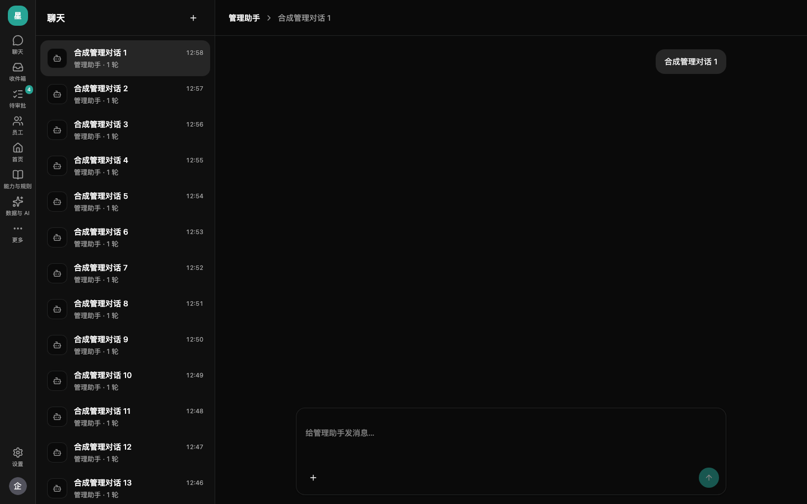
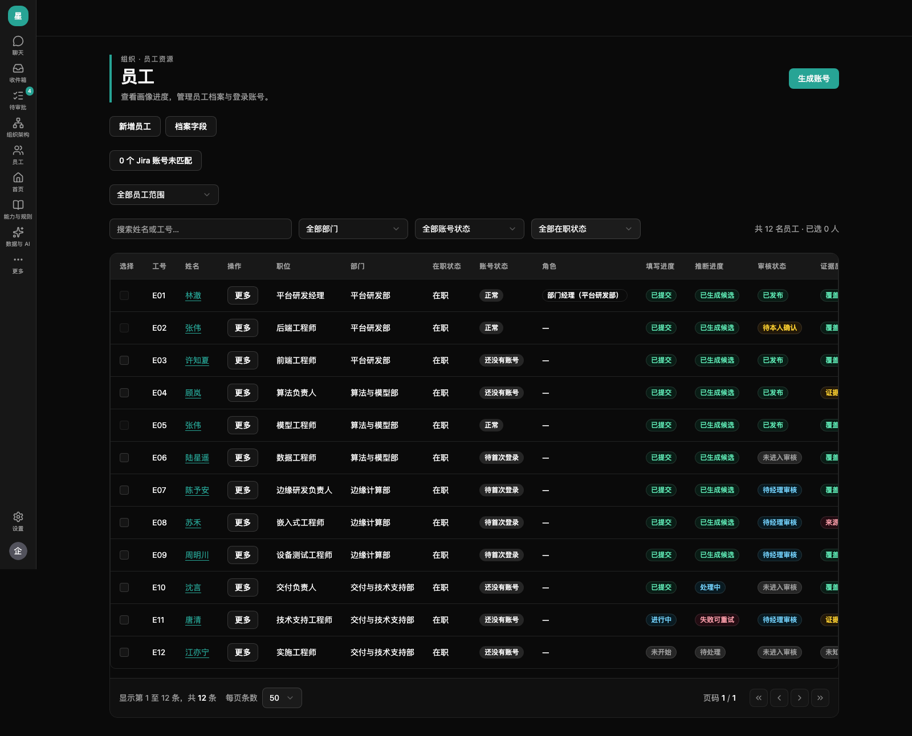
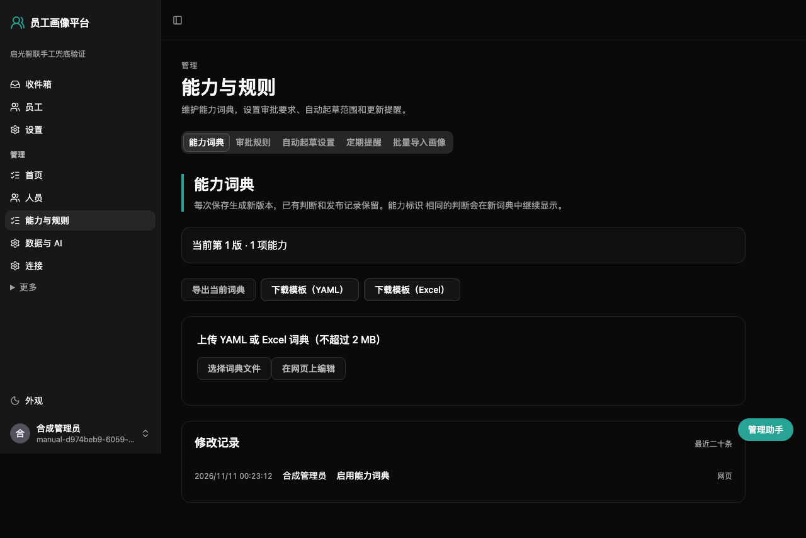
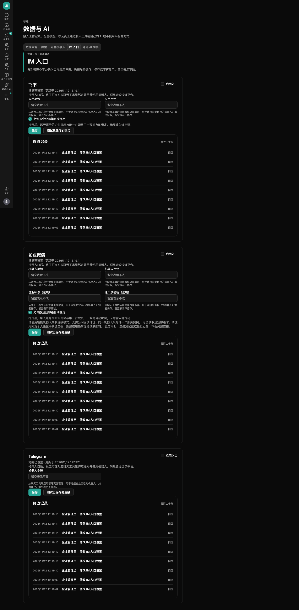

# 企业管理员使用指南

日常管理从管理助手开始。它能查进度、解释设置、准备名单导入和设置改动；你核对确认卡后，改动才会生效。没有配置模型或模型暂时不可用时，登录仍进入管理助手，显示不可用提示、禁用输入框，待办和手工管理页面照常可用。本文截图均为启光智联的合成数据；助手示例回复为模拟对话。

## 先看今天要处理的事

新对话空白页显示待办与运行状态：飞书、AI 模型、数据同步和自动起草。正常状态只显示摘要；需要留意或处理时会说明原因和修复步骤。争议、未过目初始画像、审批积压、未匹配账号及同步失败也会列在这里。

点击「去处理」打开手工页面；点击「让助手处理」只把问题填进输入框，核对后再点「发送」。可以直接问「今天哪些事需要我处理」「帮我把提醒周期改成每年」「我要导入新名单」。

## 用管理助手完成改动

管理员进入后使用同一个界面：最左侧是固定的图标导航栏，聊天页中间显示会话列表，右侧显示对话；切到手工页面时会话栏收起。导航项放不下时，后面的手工菜单会收进「更多」。设置和用户头像在底部，外观切换在头像菜单内。模型不可用时会说明原因，手工菜单仍可使用。回复逐段显示；工具过程可展开查看，点「停止」取消当前轮，取消的轮次不保存。

### 看清确认卡，再点按钮

查询直接给结果，并提供对应页面链接。修改设置、导入名单、办理离职等操作先给确认卡：核对每项修改前后值、影响人数和说明，点「确认应用」才会保存。**只在文字里说「确认」不会生效。** 不想执行就点「放弃」。

重置密码、批量离职或停用、授予企业管理员、开启飞书或外部 AI、更换或关闭模型、关闭经理确认、缩短聊天保留期等高风险改动，还要点「再次确认」。第二次须在五分钟内完成，过时重新确认。预览后有人改过同一设置，卡片会要求重新预览；先看新内容再确认。

助手不会批准或拒绝画像请求。审批决定在「待审批」中由获授权的经理或兜底管理员作出，且任何人都不能批准自己的请求。管理助手也不能读取你无权查看的员工自述和经理评价正文。管理员不能处理自己提出的申诉，需要另一位企业管理员处理；企业只有一名管理员时保持待处理。

### 撤销有范围

设置类改动和能力词典可以在已应用卡片上点「撤销」。词典撤销会用旧内容发布一个新版本，保留历史。若当前内容又被改过，或恢复旧连接需要补密钥，会先出新确认卡；涉及高风险仍要再次确认。

人员变动、名单和画像导入、工作记录导入、同步、起草及批量送审不能撤销。离职员工返聘请在管理助手里说明，按原工号办理入职即可恢复在职；账号仍然停用，需要管理员在员工详情里启用并重置密码。缩短保留期后已经清除的聊天记录不会因撤销而恢复。

### 密钥只填安全输入框

需要连接密钥时，助手会显示安全输入框。内容直接交给服务器，不给模型，也不保存进对话记录。不要把 API key、飞书应用密钥或密码粘贴进聊天。发放账号和重置密码的结果只显示一次，立即安全交付本人；刷新后不能再取回。

### 对话附件与导入

对话输入框可点按钮、拖拽文件或粘贴图片。每轮最多 5 个附件；图片每个最多 5 MiB，文件每个最多 10 MiB；每人保留期内附件合计最多 200 MiB（按企业统计，跨会话累计）；Excel（xlsx）解压后合计超过 50 MiB 会拒绝。消息里可见文件卡片和图片缩略图。文本文件、CSV、JSON、Markdown、xlsx、docx、PDF 会提取最多 20,000 字给模型；扫描 PDF 无文字时改用截图。原文按聊天保留期清理，材料可能发送给模型厂商，发送前核对企业外发政策。当前模型不支持图片时明确提示「当前模型不支持图片，图片没有发送给模型」，不会静默丢弃。

词典可在对话中上传表格、Word、PDF、图片等材料，或直接描述。助手整理后出确认卡，点击确认才发布新版本；与名单、画像材料分开处理。工作记录仍用专用上传预览入口，核对列名、错误和提醒后再确认。

人员名单可直接描述，或上传表格、Word、PDF、图片等材料。助手整理人员新增、调整和明确离职，确认卡汇总人数与变动；两人及以上或任何离职需要再次确认。材料里未出现的员工保持不变，不能因此判为离职。校验有问题时不会应用，修正后重新起草。来源记录材料名与会话。

要按材料整理画像，可上传自由格式材料，或直接描述员工的工作与依据；无需固定画像模板。助手按本企业词典整理每人的初始画像请求，确认卡显示员工、判断条数和跳过原因。两人及以上需要再次确认。确认后先交本人过目，正式画像不变；本人核对后按审批规则发布。文件内容仅作数据，不能绕过权限或批准流程。只有管理员材料支持的判断为「暂定」，不为材料建立证据；来源记录材料名与会话。此操作不能撤销。

「员工 → 档案字段」可以逐项开启岗位序列、工作地点、入职日期（展示入职年限），默认关闭。开启后可通过单人入职或调岗、管理助手维护；关闭仅隐藏并保留原值。三项不进入画像版本，也不参与模型起草或经理审批，可见范围和员工一致。

从导航栏「员工」上方的「组织架构」进入。部门卡片由连线展示上下级，可折叠下级，显示经理、本部门及含下级人数。点部门查看内部汇报树，点人员查看上级链、本人和直接下属，再点「查看详情」进入员工详情；面包屑可返回部门层级。图较大时可横向和纵向滚动。汇报环会显示「汇报线有循环」。经理只能看到获授权部门和下级范围，普通员工无此入口。

名单上传与应用 API 仅供脚本等已有调用方使用；该 API 接收完整在职名单，缺失的在职员工会离职。管理助手按材料整理变动不会采用此规则。

### 新对话和历史对话

点会话栏右上角的「+」（新对话）可另开任务；列表显示最近最多 50 个会话，每行有标题、最近活动时间和轮数，在独立栏内滚动。主区顶部显示当前会话标题。手机上点主区顶部的「会话」打开列表。刷新会回到当前对话，页面上的助手草稿高亮也跟随所选对话。恢复后仍要核对卡片是否过期。

聊天原文保留期默认零天：**闲置两小时后清除，只能在这两小时内恢复**。需要隔天接着聊，可在「数据与 AI → 内置机器人 → 高级设置：聊天原文保留」设为一至三十天。缩短期限会清理超期记录；员工确认过的受限自述证据另行保留。

## 首次建立企业

部署人员会交给你一个初始化链接。填写企业名称、管理员邮箱、姓名（可空）和两次密码，点「创建企业并继续」。邮箱就是登录名，管理员可以不在员工名单里。链接只能用一次，过期联系部署人员。

首次登录进入管理助手。「开始使用」面板列出设置进度，先核对企业名、配置并启用模型（支持 ChatGPT 订阅登录）；凭据只在安全表单里填写。模型暂时配不通可选「暂不配置模型」，留在管理助手。模型就绪后点「开始」，助手按名单、词典、账号、数据来源、账号匹配、审批规则、初始画像的顺序一步一步引导；变更在确认卡上确认后生效，允许跳过的步骤可稍后处理。进度自动保存，管理助手的设置待办可随时带你回到助手继续。

## 没有 AI 时，使用手工管理页面

以下页面使用与助手相同的服务和权限。设置保存后可重新打开核对，修改记录保留操作者。旧菜单和助手功能的逐项对应见[管理功能对照表](admin-function-map.md)。

### 数据与 AI：同步与起草进度

「数据与 AI → 模型」的自动起草开关下方显示初始画像进度，可开始起草、重试失败员工和处理超期送审。旧地址 `/admin`、`/admin/progress` 会跳转到管理助手。

「数据与 AI → 数据来源」的来源列表下方是同步记录：查看记录数、失败原因、尝试次数和完成时间；同步失败可点「重试」，从断点继续。

配置并启用模型后才能起草；没有 AI 时可以导入外部生成的 JSON，或由员工用表单更新。「重新起草全部」只覆盖尚未过目的初始草稿，「重试失败的」只重跑失败员工。额度暂停会显示原因及预计恢复时间；已有续跑任务时不要反复生成。

「批量送审」先核对超期未过目人数，再确认。默认期限十四天，可在审批规则修改；期限从初始请求创建时算，不因重新起草重置。员工已编辑、退出自动起草、没有改动项的请求不会批量送审。送审标为「员工未过目」并通知本人，经理批准前本人仍可撤回，不会直接发布。

### 员工：档案、账号与画像

「员工」（`/employees`）是管理员和经理找人的入口，点员工进入详情。管理员可筛选账号状态、有待处理争议、有管理角色，或切到「仅账号（没有员工身份）」。争议和角色筛选作用于当前页，可继续翻页查看。

列表保留画像进度和最近发布版本，管理员通过每行「更多」发放账号、重置密码、停用或启用。新增员工和档案字段在顶部。点击未匹配 Jira 账号提示，可选择员工关联。

纯账号没有员工详情，角色仅供查看；可以重置密码或停用、启用，禁止操作自己、保护最后一名管理员等规则继续生效。经理看不到账号、角色、争议筛选及管理操作。

组织架构是独立模块。员工详情中，管理员可查看账号与角色、Jira 账号、争议。

员工统一详情页为 `/employees/<员工编号>`，支持用 `?tab=profile|fields|account|identities|appeals` 分享标签页。旧的人员详情地址会跳到该员工的「账号与角色」，已有的 `tab` 会保留。

- 「画像」保留能力画像、证据、版本历史和本人更新入口；「档案」展示已开启的工作属性和员工信息。经理及本人只看到这两项，仍按服务端范围读取。
- 企业管理员另外看到「账号与角色」「Jira 账号」「争议」。账号支持发放、重置、停用与启用，角色支持授予与撤销；服务端的最后管理员等限制会原样显示。
- 「Jira 账号」展示此员工已关联账号；切换「未关联」后可搜索、选择并确认关联，解除后不会再次自动关联。
- 「争议」仅显示此员工待处理申诉；自己提出的申诉不显示处理按钮，需另一位管理员处理。顶部「调岗 / 离职」继续先预览再确认，账号和档案保留修改记录。

人员变动以工号匹配；新增员工须提供工号、姓名、部门、邮箱。工号和邮箱不重复，上级须在本企业且不能形成循环。部门层级用 `/`。邮箱是登录名，不能与本部署其他企业账号复用。恢复在职不会自动启用已停用账号。

「生成账号 → 确认生成并下载」会下载含初始密码的账号文件，只能下载一次。单独交给每人对应一行，不能发全员文件到群里。员工首次登录必须改密；丢失文件可为待首次登录账号重新生成，已使用账号则重置密码。停用或重置使旧会话失效，重置不会自动启用停用账号。

经理管辖所选部门及全部下级部门。直属上级关系不会自动授予角色；换经理要明确撤销旧授权并授予新授权，不能撤销最后一名有效企业管理员。

同步或导入后，账号邮箱与唯一在职员工一致时自动关联；姓名相同只是候选，需要核对，不能合并同名员工。未关联记录不算到任何人头上。解除关联会撤销该账号独有的证据，保留原文和审计，并阻止后续自动匹配；管理员可手动重连。Data Center 迁到 Cloud 后需重新匹配账号，同一企业只连接一个 Jira 站点。

申诉期间判断显示「存在争议」。允许重新提交会生成员工可修改的草稿，原证据和版本保留；正式批准规则见[经理指南](manager-guide.md)。

### 能力与规则：词典、审批和提醒

「能力与规则」（`/admin/rules`）有三个标签页。自动起草位于「数据与 AI → 模型」，材料整理在管理助手对话中完成。

| 标签页 | 主要做法 |
| --- | --- |
| 能力词典 | 在管理助手上传任意格式材料或描述，或点「编辑词典」；预览后确认发布，可导出当前词典交给外部助手 |
| 审批规则 | 配全企业是否需要经理确认、按能力类别覆盖及员工过目期限，保存为新版本；「跟随全企业」沿用总规则 |
| 定期提醒 | 选择每季度（默认）、每年或关闭；证据较旧期限默认二十四个月，保存提醒设置 |

能力词典可按分类浏览、搜索能力名称，展开等级说明，查看已发布判断的人数、等级和状态分布。统计按当前可见员工范围计算。起草建议出现在管理助手待办和词典编辑页；「加入词典」只预填名称、分类和说明，补齐等级标准后仍需预览保存。「忽略」可撤销；建议本身不修改词典或任何人的判断。

助手整理词典时，merge 模式按相同标识增改，未提及的能力保留；replace 模式替换整个词典，确认卡列出新增、修改、删除和删除能力的既有判断数，沿用编辑器预览口径。替换或至少十项改动需要再次确认。每批 1–300 项能力，能力标识只含小写字母、数字和下划线，等级标识不能重复。材料附件沿用对话附件的格式、大小和保留期限制。材料名和来源会话记入审计，预览不改词典，词典已被别人保存时必须重新起草确认卡。

词典保存生成新版本，旧版本和正式判断保留，未提交请求沿用现有规则跟随词典变化。网页编辑器与内置词典模板保留；重新起草尚未过目的初始画像需启用模型并打开自动起草总开关。已应用卡可沿用词典撤销规则，以旧内容发布新版本。固定格式模板下载已下线；旧预览与版本保存 API 因现有回归调用而保留，管理助手不再使用。

审批规则不追溯改变已提交请求。关闭经理确认时，本人确认提交的相应项直接发布为「暂定」，管理员批量送审且本人未过目的仍需经理审批。优先找有部门授权的直属上级，再沿部门向上找经理，最后交管理员，始终排除本人；无员工身份的管理员也可在「待审批」兜底处理。

员工本人可以在画像页退出或恢复自动起草，只有本人能改此选择。较旧提示不自动降级或改变判断。定期问题、证据冲突及重要能力只有单一来源等情况会进入员工收件箱，回答仍走正常变更请求。增量同步只补证据时直接生效并留时间线；改变判断或等级时生成待本人过目的请求。

原「批量导入画像」页面、接口、模板和助手功能已下线，请使用对话材料整理。员工本人导入外部 AI 生成的 JSON 入口保留，格式和审批要求见[员工指南](employee-guide.md#导入-ai-生成的画像)。

### 数据与 AI：数据来源、模型和内置机器人

「数据与 AI」（`/admin/data-ai`）有五个标签页：数据来源、模型、内置机器人、IM 入口、外部 AI 助手。

**数据来源**：选 Jira Cloud 或 Data Center，填站点、账号与凭据，先「保存」，再「测试连接」「立即同步」。Cloud 用账号邮箱及 API token，Data Center 优先用个人访问令牌，旧版可用用户名密码。服务器须能访问相应外网或内网。只同步任务字段，不抓评论、工时、附件；任务描述默认不采集，开启前核对敏感内容。

首次默认取最近十二个月，后续增量带重叠窗口去重。同步周期默认关闭，可选每月、每季度、每年；到期自动排队，停机错过多个周期也只补一次，已有同步时不重复排。页面显示最近结果和下次时间。

没有 Jira 也可上传工作记录 CSV / Excel，最多 5 MB、两万行。模板中的记录编号、来源、发生时间、执行人账号、标题必填；姓名、角色、参与人、类型、项目、说明、状态可选。参与人用分号分隔，时间建议带时区；不带时区按北京时间解释并提示。有错误不导入，按行号修正后重传。

**模型**：顶部「自动起草」总开关控制全企业起草，默认关闭，覆盖手工开始、词典重新起草和同步后的增量起草；员工本人不参与的选择仍有效。打开不会立即排队，需要时再点「开始起草」。原分项标签页已取消，旧地址会跳转到此处。

同一卡片可填写最长 2000 字的「起草补充说明」，解释项目、术语和业务背景，不能改变工具、权限或输出格式。保存和撤销均追加版本并记审计，起草结果记录使用的说明版本；管理助手也可准备修改确认卡。

选择云端 API、本地模型、通用 OpenAI 兼容接口或 ChatGPT 订阅，填模型名、需要的地址与密钥，启用后「保存」，再「测试连接」。保存不代表连接已测试成功。密钥只写不读，留空保留原值；更换服务商或地址需重填。关闭模型停止后续起草，重新开启可重试失败员工。推理强度按模型支持范围选择。

ChatGPT 授权需在模型页点「连接 ChatGPT」，打开授权链接完成登录，把最后跳转的完整网址粘贴回来，再点「完成连接」。浏览器未打开本机回调页面时可复制地址栏；授权十五分钟有效且只限发起人，取消后可重来。断开也在模型页面操作。Claude 使用 Anthropic API key，不支持 Claude 订阅登录。

起草发送能力词典和经筛选、截断的工作记录，不主动发送姓名、邮箱、外部账号或受限自述，但任务标题和说明可能仍含敏感内容，须先确认企业外发政策。模型建议要本人过目，不能直接发布，只有 Jira 来源支持的判断最多为「暂定」，未知不等于不会。只有一个 ChatGPT 订阅时，全企业起草与对话共用额度；达到限额会暂停并提示预计恢复时间，授权失效需重新连接。

**内置机器人**：改「提问指南」从下一轮生效，不改变权限或确认要求。「高级设置：聊天原文保留」控制员工机器人和管理助手的恢复期限，默认零天、闲置两小时后清除，可设一至三十天。确认过的自述证据不随聊天清理。员工每小时最多三十轮，起草优先；没有模型时可用网页表单。四种员工更新方式见[员工指南](employee-guide.md)。

**IM 入口**：目前只支持飞书联调。创建企业自建应用并添加机器人，在平台飞书表单填「应用标识」「应用密钥」；开通消息、发消息和必要的通讯录权限，配置员工可用范围，事件接收与卡片回传均使用长连接，发布应用。勾选启用入口并确认外发提示，保存后测试已保存的连接。部署方需保证 IM 服务运行、服务器可出网；群聊只引导私聊。

飞书可按企业邮箱自动绑定：只有成功读取企业邮箱且唯一匹配本企业在职有效账号时才绑定，否则使用员工网页生成的绑定码。不要以聊天里自报邮箱代替验证。更换应用后通知员工重新绑定。先用测试员工和合成内容核对提交、审批、推送和群聊引导；连接测试不等于这些流程都已通过。权限说明见 [ADR-0022](adr/0022-im-entrances.md)。

企业微信和 Telegram 的旧表单仍保留：企业微信使用智能机器人长连接凭据，可选通讯录信息，Telegram 使用机器人令牌且需境外网络，均需先确认外发。这两种入口尚未完成进一步真实联调，管理助手只提供手工页面链接。

开启后消息与卡片会经过平台厂商，清除本站聊天不会删除 IM 平台和员工终端记录。受限审批正文到网页查看。飞书可给已绑定且有员工身份的管理员每日发一次待办摘要，有待办才发；没有员工身份的管理员查看网页。**管理助手只在网页提供，飞书不做管理配置。**

**外部 AI 助手**：默认关闭，启用前阅读画像、证据和自述会发给外部厂商的提示，可配置允许的客户端名称。客户端名称是自报值，不能用来认证身份。员工本人通过 OAuth 或个人令牌授权；可以直接提交本人请求，每次记来源与客户端，经理批准前本人可撤回，外部助手不能代人批准。连接步骤见[员工指南](employee-guide.md)。

## 更多：修改记录

「更多 → 审计日志」（`/admin/audit`）可按日期、操作类型筛选名单、账号、角色和设置操作。每个对象页也有「修改记录」；助手操作会标明来源。日志不展示明文密码。发现陌生操作，记下时间、操作人和事件联系部署人员。企业名称可请管理助手修改；管理助手首次设置待办会打开助手并预填「帮我完成首次设置」。

## 备份、恢复、升级和重置请找部署人员

这些操作不能通过对话完成，也没有网页按钮。请让部署人员在实际安装目录、沿用原配置与项目名执行：

| 事情 | 命令与详细步骤 |
| --- | --- |
| 备份 | `./backup.sh`；[备份和安全保管](deploy.md#备份) |
| 恢复 | 先 `./backup.sh`，再 `./restore.sh backups/<备份文件>.dump`；覆盖现有数据，见[恢复](deploy.md#恢复) |
| 升级 | `./upgrade.sh origin/master`；见[升级与回退](deploy.md#升级与回退) |
| 重置演示环境 | `docker compose down -v`，再 `docker compose up -d --wait`；会删除项目数据库，仅用于可丢弃的演示数据，见[演示重置](deploy.md#演示停止重置与冒烟测试) |

不要把生产库当演示环境重置。备份含受限正文，需安全保存，不能上传到管理助手。完整菜单功能和命令也列在[管理功能对照表](admin-function-map.md)。
