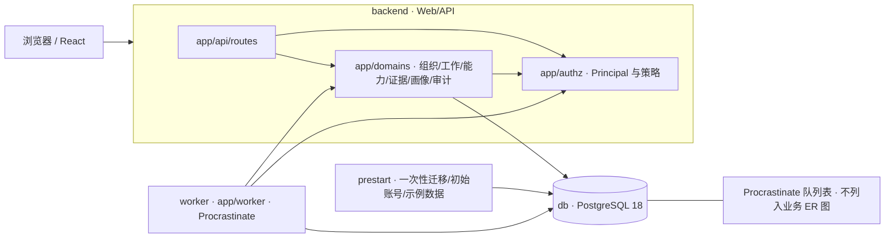
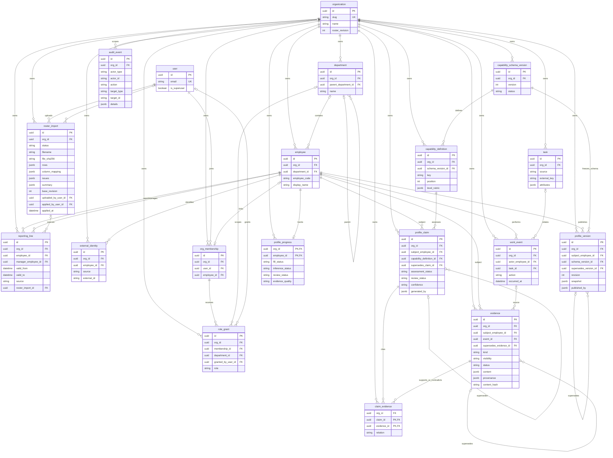

# 架构与扩展位置

M0 是合成企业数据的只读演示：4 个部门、12 名员工、12 项能力。FastAPI 提供 Web/API，React 构建产物由同一进程托管；所有业务数据和任务队列共用 PostgreSQL。画像、Claim 和历史版本由种子数据预置，尚无模型推断或审核发布入口。

## 进程与模块

`compose.yml` 定义 db、prestart、backend、worker。db 健康后 prestart 执行 Alembic、初始化账号和演示导入，成功退出后才启动 backend / worker。两者复用后端镜像；默认只有 Web/API 的 `127.0.0.1:8000` 发布到宿主机。开发服务在 `compose.dev.yml` 中显式选择，HTTPS 部署见 [deploy/README.md](../deploy/README.md)。

路由负责 HTTP 参数和响应，`app/authz` 负责服务端租户身份解析与权限策略，`app/domains/*` 放模型、响应 Schema 和领域服务。`app/seed` 校验并幂等导入合成数据。Worker 当前仅有无业务数据的 `system.ping`；未来业务任务经 `tenant_task(org_id, body)` 校验租户，任务中的查询仍显式限定租户。队列迁移和健康检查限制见 [ADR-0002](adr/0002-worker-and-compose-layout.md)。

## 核心对象与实际表

下图对应 `backend/app/domains/*/models.py`、模板 `app/models.py` 和 Alembic：18 张核心业务表，加登录账号 `user`；登录限流表 `login_attempt` 和向导状态表 `setup_step_state` 不列入此图。各框只列身份、关键引用和主要业务字段，不穷举所有列。`TenantRecord` 表共同具有 `id`、`created_at`、`org_id`；Organization 自身就是租户，AuditEvent 的 `org_id` 可空以表示平台事件。

业务引用使用 `(org_id, x_id) → (org_id, id)` 复合外键，避免跨租户串联；登录账号引用为普通 `user.id` 外键。`audit_event.actor_id/target_id` 和 `profile_version.published_by` 是归因信息，不是外键。`org_membership.employee_id` 可空，非空时在组织内唯一；同名员工靠显式 external_identity 关联，不能按姓名合并。

部门按 `(org_id, parent_department_id, name)` 唯一，使用 `NULLS NOT DISTINCT`，同名顶层部门仍冲突，不同上级下可同名。`reporting_line` 禁止自我汇报，每名员工最多一条 `valid_to IS NULL` 的当前记录。`roster_import` 保存解析后的行、列映射和预览版本，不保存原文件；`organization.roster_revision` 初始为 0。只读的 `compute_roster_diff` 用固定 5 次查询生成变化、部门树、提醒和阻断原因，缺少可选列时保留现值。上传、确认导入和版本号递增由后续 S6b 实现。

能力词典每个组织最多一个 active 版本；定义的 `key` 在词典版本内唯一，`position` 是 S5 加入的展示顺序。Claim 指向具体版本的能力定义，判断状态与审核状态分开，信心标签不能视为概率。画像按词典补齐无 Claim 的未知项。

Evidence 追加服务在 `app/domains/evidence/service.py`，以组织、来源、来源引用和内容哈希保证幂等。原始正文和归因不可修改；撤销/替代状态变化须同事务追加审计，更正正文追加新 Evidence 并指向原记录。M0 没有修改接口或数据库触发器，写协议的完整执行留待 M1。ProfileVersion 冻结判断字段和证据引用，不复制受限正文；读历史时仍检查当前证据权限。详见 [ADR-0001](adr/0001-tenancy-and-core-objects.md)。

## 租户与权限

`/api/v1/orgs/{org_id}/...` 的 Principal 由服务端通过当前用户、成员资格和角色授予解析，客户端不能指定自己的角色。员工不是登录账号；平台 `is_superuser` 也不自动授予任何组织权限。

| 角色 | 员工、画像、进度和 standard 证据 | restricted 自述与经理评价正文 |
| --- | --- | --- |
| 企业管理员 | 本组织全部 | 仅元数据；如另有本人/经理身份才按该身份读正文 |
| 部门经理 | 管辖部门及本人 | 管辖部门及本人 |
| 员工 | 本人 | 本人 |
| 系统 Worker | 任务所属租户 | 任务所属租户 |

角色叠加，部门权限不继承子部门。列表、搜索和计数在 SQL 中用同一个可见范围条件；无成员资格或员工不可见统一返回 404。受限证据保留元数据并标记 `redacted=true`，详情不返回正文。数据库复合外键负责引用完整性，应用授权负责读取范围；尚未开启 RLS。详见 [ADR-0003](adr/0003-authz-and-tenant-context.md)。

## 三类 Slot

| Slot | 代码位置与边界 | 当前状态 |
| --- | --- | --- |
| Source Slot | `connectors/` 接来源；`app/domains/work` 承接 Task/WorkEvent，`app/domains/evidence/service.py` 追加 Evidence | 目录和追加服务已在；`app/seed` 仅导入合成样例，正式来源插件待 M1/M3 |
| Profile Slot | `app/domains/profile` 使用 Evidence 与版本化 capability 产生候选 ProfileClaim，经审核冻结 ProfileVersion | 当前仅查询服务和种子 Claim；生成、审核和发布待 M2 |
| Interaction Slot | 后续连接待确认问题、人类回答及统一 Review 流程，回答回到证据/候选判断 | 未实现，没有问题表或交互协议 |

来源插件只提交事实和证据，不直接发布画像；模型只产生候选 Claim。未来模型接入须可替换、可完全关闭，使用输入白名单并记录模型及 Schema 版本。M0 不调用外部模型。

## P1–P6 扩展位置（尚未实现）

以下只描述未来接入点，不构成现有表、API 或调配承诺；实施前需独立规划与 ADR。

| 扩展 | 未来接入对象或接口 |
| --- | --- |
| P1 需求登记 | 新需求对象关联 Organization、Department 和所需 CapabilityDefinition 版本；需要时关联 Task，不把需求混入 Evidence |
| P2 资源容量 | Employee 关联独立的时间/容量记录；不从画像等级推导空闲时间 |
| P3 跨部门流程 | Organization、Department、Employee 关联独立申请/确认记录，复用服务端 Principal、授权和 AuditEvent |
| P4 匹配优化 | 读取已确认的 ProfileVersion、需求与容量，输出可解释候选方案；不修改原始 Evidence 或自动形成考核结论 |
| P5 反馈重规划 | 执行结果进入 Task/WorkEvent，经 Source Slot 追加 Evidence，再经 Profile/Review 流程更新画像；方案调整另留版本和审计 |
| P6 组织洞察 | 基于授权范围内的 ProfileProgress、词典和发布版本聚合；总体进度不能成为读取自述正文的权限 |
