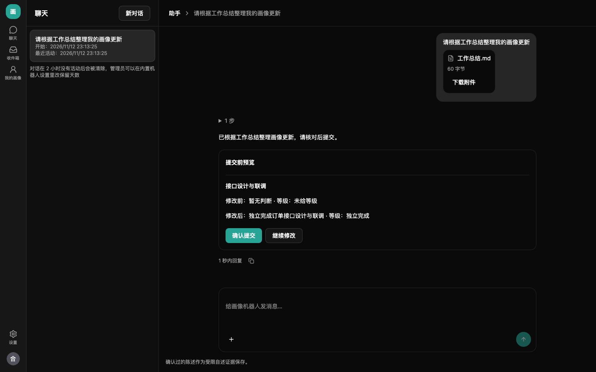
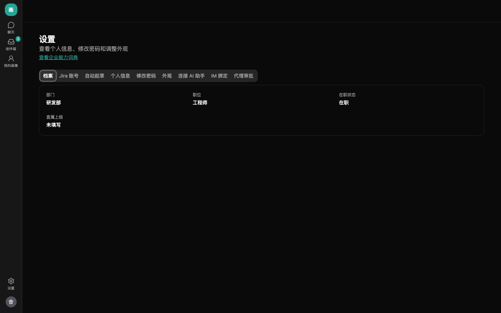
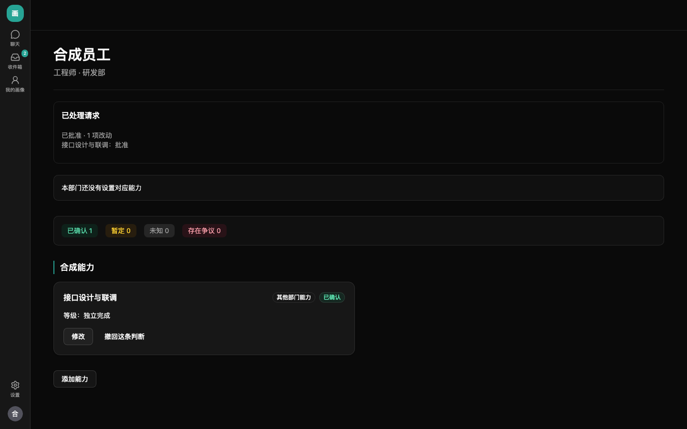
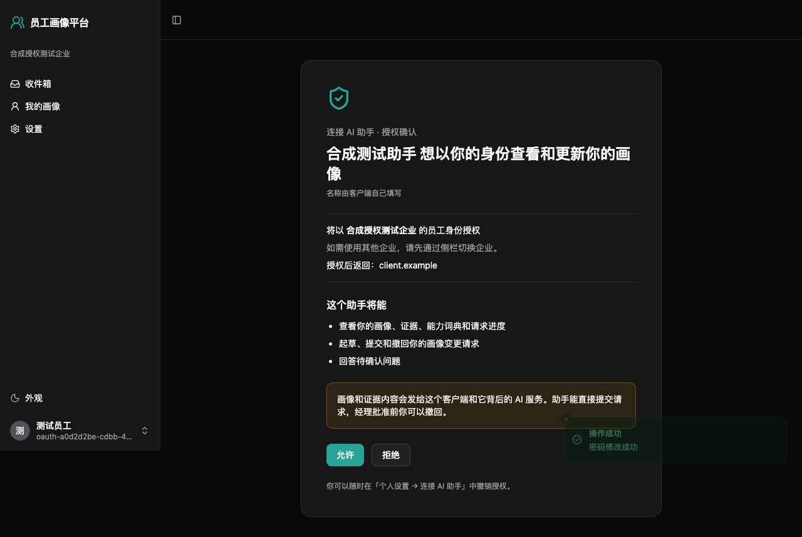

# 员工使用指南

文字已按 M4.5 更新；截图保留 M4.3 的界面，操作以文字说明为准。

## M4：查看审批结果、修改与申诉

提交后在收件箱和本人画像的请求卡片查看审批结果。部分批准的项立即发布，其他项不会一起生效；精简后的画像页不再展示请求时间线和版本历史。

退回项生成关联的新草稿。点「查看退回草稿 → 继续修改」，补充依据后先预览再提交；原请求及原因保留。拒绝项可以填写原因发起申诉，关联判断显示「存在争议」。管理员维持原决定或允许重新提交后，在结果中查看说明；允许重提仍需你修改并正常送审。

经理本人也只能提交自己的更新，不能批准自己的请求。只有 Jira 来源支持的判断即使批准也最多是「暂定」。企业关闭经理确认的能力类别在你确认后直接发布为暂定。

正式画像也可以由企业管理员或管辖经理直接修改，改后通知本人（E21）；他们不能直接修改自己的画像。系统自动起草仍先交本人过目。直接修改的通知和异议处理见下文。

## 谁能看到我的画像

| 内容 | 谁能看到 |
| --- | --- |
| 正式画像的能力、等级、状态和陈述 | 本人、管辖经理（包括获授权的上级部门经理）、企业管理员 |
| 依据说明和受限自述正文 | 本人和管辖经理；经理在网页审批页查看，助手工具不提供下属这些正文和来源 |
| 未提交的草稿 | 只有本人 |

管辖范围包含获授权部门及其全部下级部门。管理员身份本身不授予受限正文权限，兼任本人或管辖经理时按相应身份授权。查看画像或自述不通知本人，也不留应用内查看记录；直接修改发布后会通知本人。画像页和填写表单的「谁能看到」可展开查看同样说明。

审批时还有临时读取例外：当前请求的获授权审批人（含代理人、兜底管理员）在待审批期间可以读取该请求引用的受限内容；处理完毕或代理失效后恢复原权限，不扩展到其他请求或整个部门。

## 助手、我的画像和设置

用管理员提供的员工邮箱登录，首次登录按提示修改密码。登录后进入「助手」：最左侧是图标导航栏，中间是历史对话，右侧是对话区。员工有「聊天」「收件箱」「我的画像」和底部「设置」；经理还会看到「待审批」「我的团队」「组织架构」。手机上点「会话」切换历史对话或新建对话。

回复逐段显示，工具调用过程可展开，点「停止」取消当前轮。未配置模型、额度不足或服务暂时不可用时，按会话区的中文提示处理；「我的画像」和设置仍可使用。每人每小时最多三十轮，ChatGPT 订阅的企业共用该账号额度，起草任务优先。画像用于协作找人，不用于绩效、薪酬和晋升。

处理超过三分钟会明确提示超时和分批办法，可缩小本次要处理的材料范围后继续；冷却和额度恢复提示使用北京时间及预计等待分钟数。需要退出时，点导航底部直接可见的「退出登录」（手机先展开菜单），回到登录页会显示「已退出」。关标签页不等于退出。



「设置」中有档案、Jira 账号、自动起草、个人信息、修改密码、外观、连接 AI 助手、IM 绑定和代理审批。档案展示部门、职位、上级以及企业开启的工作属性；Jira 账号查看已关联身份；自动起草可由本人退出或恢复；「连接 AI 助手」可下载外部生成指南（skill），设置顶部可查看企业能力词典。档案与账号信息不再放在画像详情中。



## 在网页更新画像

「我的画像」的能力卡显示能力名称、等级和状态；点击名称打开只读详情，查看完整陈述和北京时间的最近更新时间。未定级的判断在卡上显示陈述摘要，单列「未定级」，不算进「已确认」数字；否定或仅协助的含义应结合陈述理解。画像页不展示依据、证据或来源。系统起草时未给出等级的判断不会进入新起草结果，证据不足不表示没有能力。

空画像会说明是等待接入工作记录、没有记录、等待起草、起草中、待本人过目、未生成判断还是起草失败，并引导「添加能力」或去助手补充。「未生成判断」表示有记录但起草时定不了等级，不表示你不会；「状态待确认」可联系管理员核对。

默认列本部门及上级对应的能力，并保留已有内容和有待处理改动的能力。已有内容但不属于本部门的项标「其他部门能力」。未配置时提示「本部门还没有设置对应能力」；仍可处理已有能力。部门词典没有合适能力时，对应能力可能为空。



在能力卡或只读详情点「修改」（未知项点「填写」），可选「手动编辑」或「让助手改」。手动填写陈述、等级（本人修改时可留空）和依据，保存草稿后可从「继续修改」恢复；「添加能力」可搜索当前词典中尚未显示的项。已有判断可撤回，移出词典的能力只读。选择「让助手改」会打开助手并预填能力和当前等级，核对输入后再点发送。

搜索不到时点「建议新增这项能力」，填写名称、能力说明和为什么需要，再提交建议；也可让网页或飞书助手整理建议，先核对名称和说明并明确同意。建议交管理员决定，不会直接改词典或画像；管理员加入词典后才能添加该能力。每人最多五条待处理建议，同名待处理建议不会重复创建。

手动编辑未保存就关闭或站内离开时，可选择保存草稿、放弃或继续编辑。助手未发送的文字在同一登录用户、企业和会话下切换页面后可恢复，发送成功后清空；刷新后不保留，也不缓存未发送附件。

系统自动起草的初始画像先由你过目，可直接提交、修改或提异议。手动编辑点「预览并提交」，核对后点「确认提交」；助手则在预览卡上点「确认提交」，文字回复不能代替按钮。内容变化时重新预览。默认提交后为「待经理审批」，批准前可撤回，正式画像尚未变化。企业关闭经理确认的能力类别由本人确认后直接发布为「暂定」，已发布的项不能撤回。只有 Jira 支持的判断即使批准也最多为暂定。

提交前预览和待审批请求会显示当前审批人的姓名与身份（直属上级、部门经理、企业管理员或代理人）；它会随授权和代理变化，不代表固定指派。暂无可用审批人时联系企业管理员。请求卡可展开提交的陈述。问助手进度时，助手按当前请求状态回答；对已发布判断有异议仍走修改请求，正式申诉只针对被拒绝的改动。

依据说明和异议作为受限自述证据保存，常规读取限本人和管辖经理，审批临时例外见上节；撤回不删除原证据。初始画像超过企业过目期限（默认十四天）仍未处理时，管理员可批量送审并标「员工未过目」，你仍可在批准前撤回。

## 上传材料，让助手整理画像

在助手输入框点「添加附件」、拖入文件或粘贴图片，可提供简历、工作总结、外部 AI 生成的 JSON 等自由格式材料，也可以直接描述经历。原来的固定格式 JSON 导入页面已下线；外部 skill 和 MCP 保留，JSON 也可以作为普通附件交给助手整理。没有模型时可使用网页表单，或企业允许的外部 MCP 助手。

每轮最多五个附件，图片每个 5 MiB、文件每个 10 MiB；每人在企业内跨会话累计最多 200 MiB。文字、CSV、JSON、Markdown、xlsx、docx、PDF 提取最多 20,000 字；xlsx 解压后最多 50 MiB。扫描 PDF 可换截图，模型不支持图片时会说明图片未发送。

附件仅作数据，材料里的指令不能替你提交或批准。只上传有权交给模型厂商的工作材料。助手先整理预览卡，确认提交后才送审或按企业规则发布；附件不会直接成为证据，只有确认过的陈述才作为受限自述保存。上传原文随聊天保留期清理。

同一对话保留期内，之前上传的文字材料后续轮次仍可继续用；即使上传那轮超时，也可说「用刚才的材料先整理第一部分」。助手可查看最近二十个未过期附件的清单。图片只能在上传当轮看，后续要看图片需重新上传；新对话不能读取旧会话附件。

## 飞书入口与聊天保留

管理员开启入口后，到「设置 → IM 绑定」生成一次性绑定码，在机器人私聊发送（可加「绑定」前缀）。过期重新生成；飞书和企业微信也可按经授权的企业邮箱绑定，Telegram 必须用码。

飞书私聊可发送文字、文件和图片，和网页使用同一套助手工具与权限。上传后说明要整理的画像内容，核对预览卡，再点「确认提交」。提示「无法读取文件，请让管理员在飞书开放平台开通文件权限」时联系管理员开通 `im:resource`。企业微信、Telegram 当前不支持这些附件；语音不在支持范围内，群聊不返回画像内容。网页和飞书会话历史不互通。

选择推送平台后可收到待过目、问题、审批结果、提醒和画像直接修改通知；解绑、企业停用入口或屏蔽机器人会影响推送，网页收件箱仍可查看。Telegram 须先 Start，企业微信须先私聊。受限正文在网页查看；本平台清理聊天不会删除 IM 平台和终端副本，Telegram 数据保存在境外。

聊天默认临时加密保存，闲置两小时后清除；企业可设一至三十天，刷新可恢复保留期内的消息。浏览器只保存会话标识，清理不删除已确认自述证据。

## 收到画像直接修改通知

管理员或管辖经理直接修改后，新版本立即发布，无需你同意或再次审批，新增和修改的判断为「已确认」。收件箱的「画像被直接修改」通知说明谁、什么时间改了哪些能力；已开启飞书推送并绑定时也会收到飞书消息。画像页不显示改动人。

如果有异议，在「我的画像」重新编辑这项能力，说明原因并提交经理审批。当前申诉入口只针对被拒绝的改动，不用于直接修改。若同一能力原有待审请求已被新版本取代，审批时会提示冲突，需要读取新内容重新提交。经理和管理员也不能直接修改自己的画像，仍走本人更新流程。

## 通过外部 AI 助手更新画像

企业管理员先在网页打开「外部 AI 助手」。ChatGPT、Claude 使用下面的网页授权；Cursor 等开发者客户端也可以在个人设置创建令牌。令牌只显示一次，请保存在客户端的凭据配置里，不要发到聊天、截图或工单。管理员允许连接后，你的画像、证据和已确认的自述会传给所选外部助手厂商。

「连接 AI 助手」显示企业已关闭时，请联系企业管理员到「数据与 AI → 外部 AI 助手」开启。使用企业提供的 HTTPS 地址；页面若显示本机 HTTP 地址，仅供本机客户端测试，云端客户端无法连接。

在 Cursor 等支持 Streamable HTTP 的客户端中，地址填写 `https://企业平台域名/mcp`，认证使用 `Authorization: Bearer <个人令牌>`。个人设置中有可复制的 Cursor 配置示例。客户端需要先初始化；允许列表按客户端自报名称匹配，不是强身份认证。

助手可以查看你的画像、证据、能力词典和请求，保存草稿，回答待确认问题。提交前先调用 `preview_request`，再把返回的 `revision` 交给 `submit_request`。提交后按企业审批规则进入待经理审批或直接发布为暂定；来源记录包含客户端名称，经理批准前可以撤回，已发布的项不能撤回。回答问题和补充依据只保存你确认的受限自述，平台不收集外部助手的聊天原文。

令牌默认 90 天到期，可以随时在个人设置吊销。改密码、停用账号、关闭企业 MCP 都会阻止已连接会话的下一次请求。连接会话一小时后需重新连接；不要把别人的会话标识放到自己的客户端。

### 经理通过外部助手审批

经理使用同一套 OAuth 授权或个人令牌，可以问「有什么要我批的」。助手用 `list_pending_reviews` 列出当前用户待审批的请求，用 `get_review` 逐项展示改动前后、依据和不确定之处，并取得 `revision`。助手必须先向经理逐项复述决定和原因，经理明确同意后，才可调用 `decide_review_items`；退回和拒绝必须填写原因。内容已变化时需重新读取并再次确认。批准与发布在同一事务内完成，记录来源 `mcp` 和客户端名称；任何人都不能批准自己的请求。

`get_team_overview` 只读汇总员工列表可见范围（本人、获授权部门及全部下级部门）的画像状态和当前用户待审批数，不返回范围外员工。经理工具沿用服务端审批权限；MCP 令牌和 OAuth 必须关联员工身份，没有员工身份的企业管理员只能在网页审批。网页助手与飞书也支持待审批查询和确认审批，操作见[经理指南](manager-guide.md)。

外部客户端必须能访问平台地址并信任 HTTPS 证书。云端客户端通常不能访问企业内网，也不能接受自签证书；本机客户端需要在本机信任企业证书后连接，是否可用取决于客户端的证书配置。

### 在本机 Codex 和 Claude Code 中连接

下面使用本机测试地址 `http://localhost:18236/mcp`；正式部署换成企业提供的 HTTPS 地址。云端连接器不能用这个 localhost 地址。先在网页「设置 → 连接 AI 助手」创建本人的个人令牌，通过终端安全输入到当前进程环境，不把令牌写入配置文件或命令历史：

```bash
# 在 bash 中执行；用完后关闭此终端，或执行 unset EPP_MCP_TOKEN
read -r -s -p '个人令牌：' EPP_MCP_TOKEN; echo
export EPP_MCP_TOKEN
```

**Codex**：在专用测试目录创建 `.codex/config.toml`，无需修改全局 `~/.codex/config.toml`。该目录必须是你信任的项目，Codex 才会加载项目配置。

```toml
[mcp_servers.epp]
url = "http://localhost:18236/mcp"
bearer_token_env_var = "EPP_MCP_TOKEN"
startup_timeout_sec = 30
```

从该目录运行 `codex`，检查 MCP 中的 `epp`，然后要求「查看我的画像」。此配置已通过 Codex 原生 MCP 客户端验证：查看画像、保存草稿、预览、提交、撤回，以及经理读取并批准另一员工的请求、生成正式版本。验证通过直接工具调用完成，没有启动模型轮次。

本机 OAuth 也已验证动态注册（DCR）、PKCE、员工授权和授权后读取画像。测试时使用只含 `url` 的独立配置，不同时设置个人令牌或 Authorization 请求头；执行 `codex mcp login epp --scopes employee` 并在浏览器核对授权。需要完全隔离客户端配置与 OAuth 凭据时，可将 `CODEX_HOME` 指向测试目录下的独立目录，在其中写 `config.toml`，再运行登录命令。不要向该目录复制其他客户端的登录凭据。

**Claude Code**：在专用测试目录创建 `.mcp.json`，保留下面的环境变量占位符：

```json
{
  "mcpServers": {
    "epp": {
      "type": "http",
      "url": "http://localhost:18236/mcp",
      "headers": {
        "Authorization": "Bearer ${EPP_MCP_TOKEN}"
      }
    }
  }
}
```

从该目录启动，以下命令把 Claude Code 自身的状态也隔离在测试目录内：

```bash
export CLAUDE_CONFIG_DIR="$PWD/.claude-test"
claude mcp list
claude --strict-mcp-config --mcp-config .mcp.json
```

本机实测 `claude mcp list` 显示 `epp … ✓ Connected`。这只证明客户端配置和 MCP 连接成功；本次未提供 Anthropic API key，尚未验证 Claude Code 的模型驱动提交、撤回和审批，不能把连接成功当作完整流程通过。测试模型请使用 Anthropic API key，不读取或复制其他应用的订阅凭据。

员工可先要求助手「读取词典，为我的一段合成经历保存草稿，预览后提交」，再要求撤回；另提交一份保留待审批。经理须在另一个会话使用自己的令牌，先读取待审批请求和逐项内容，明确同意后再批准，最后由员工查看正式画像。经理不能使用员工的令牌审批，也不能批准自己的请求。测试结束在网页吊销测试令牌和 OAuth 授权，并删除测试目录中的客户端状态；这些状态文件不能提交到仓库。

配置字段说明：[Codex 官方 MCP 文档](https://developers.openai.com/codex/mcp/)、[Claude Code 官方 MCP 文档](https://code.claude.com/docs/en/mcp)。

### 在 ChatGPT 中连接

1. 从企业管理员处取得 MCP 地址：`https://企业平台域名/mcp`。
2. 在 ChatGPT 网页打开「插件」，点击加号，选择「添加自定义 MCP 服务器」，填写名称和上述服务器地址。旧版界面可能在「设置 → 应用/连接器 → 高级 → 开发者模式」中。没有入口时，请联系工作区管理员开通权限。
3. 认证选择 OAuth，使用自动注册（DCR），无需手填客户端密钥。创建并安装插件，点击连接。
4. 在平台网页用员工邮箱和密码登录；首次登录先改密码，之后会自动回到授权页。确认企业、客户端名和回调主机，阅读数据外发提示，点击「允许」；不想连接就点「拒绝」。
5. 回到 ChatGPT，在会话中选择这个插件，尝试「查看我的画像」。

入口和权限可能随客户端版本变化，参见 [OpenAI 官方连接说明](https://developers.openai.com/api/docs/guides/custom-mcp-server)。

### 在 Claude 中连接

1. 在「自定义 → 连接器」（旧版为「设置 → 连接器」）中点击添加自定义连接器。团队版由组织所有者先添加，再由每名员工分别连接。
2. 填写名称和 `https://企业平台域名/mcp`，认证选 OAuth / 登录，OAuth 客户端选「自动注册」（Register automatically）。本平台支持动态注册，不支持「使用 Claude 发布的身份」这种客户端元数据文档方式。
3. 点击连接，用平台员工邮箱登录；首次改密后自动回到授权页，核对后点「允许」。返回 Claude 并启用连接器，再尝试查看自己的画像。

具体入口参见 [Claude 官方连接说明](https://support.claude.com/en/articles/11175166-get-started-with-custom-connectors-using-remote-mcp)。云端必须能访问平台 HTTPS 地址；仅本机能访问的地址无法用于云端连接器。

### 核对和撤销授权

授权页会写明「将以某企业的员工身份授权」。属于多个企业时，先用侧栏的「当前组织」切换，再核对授权内容。**名称由客户端自己填写**，不是平台对客户端身份的认证；允许列表也不能证明客户端可信。画像和证据内容会发送给客户端及其背后的 AI 服务。



打开「设置 → 连接 AI 助手 → 已授权的客户端」，可以看到本企业内你授权的客户端、授权时间和最近使用时间。点击「撤销」后，整条授权链的访问令牌和刷新令牌立即失效，已连接会话的下次请求会被拒绝。需要恢复时从客户端重新连接、重新授权。个人令牌在下方单独管理，OAuth 的短期访问令牌不在个人令牌列表出现。
