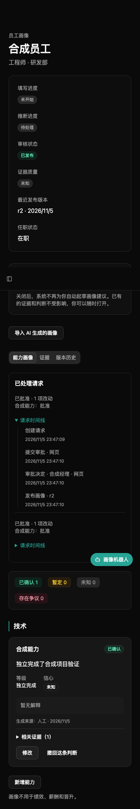

# 员工使用指南

## M4：查看审批结果、修改与申诉

提交后在收件箱和本人画像的请求卡片查看结果。逐项显示批准、退回修改或拒绝及原因；部分批准的项立即发布，其他项不会一起生效。展开「请求时间线」查看提交、审批和发布的版本；「版本历史」能比较旧版本并返回来源请求。

退回项生成关联的新草稿。点「查看退回草稿 → 继续修改」，补充依据后先预览再提交；原请求及原因保留。拒绝项可以填写原因发起申诉，关联判断显示「存在争议」。管理员维持原决定或允许重新提交后，在结果中查看说明；允许重提仍需你修改并正常送审。

经理本人也只能提交自己的更新，不能批准自己的请求。只有 Jira 来源支持的判断即使批准也最多是「暂定」。企业关闭经理确认的能力类别在你确认后直接发布为暂定。



## M4：绑定 IM 与接收通知

管理员开启入口后，到「个人设置 → IM 绑定」选平台生成一次性绑定码，在机器人**私聊**发送绑定码（可加「绑定」前缀）。绑定码短时有效且只能用一次；过期请重新生成。飞书、企业微信也可能按经授权的企业邮箱自动绑定，Telegram 必须用绑定码。

在 IM 描述经历，核对改动卡片，点「确认提交」才会送审；直接说「提交」不能代替按钮。审批前可以撤回。卡片过期或内容变化时回网页重新查看。图片、语音、文件不在当前支持范围内，群聊不会返回画像内容。

在个人设置选择推送平台，接收待过目、待确认问题、审批结果和定期提醒。可随时解绑并重选渠道；企业停用入口或你屏蔽机器人时不能收到推送，网页收件箱仍可查看。Telegram 须先发 Start，企业微信须先与机器人私聊。

发送前请确认可以把内容交给 IM 平台保存（Telegram 在境外）。受限证据正文在网页查看；本平台清理聊天不会清除对方服务器上的历史。

## 网页机器人：流式回复与附件

回复逐段显示，工具过程可展开，点「停止」取消当前轮；取消的轮次不保存。输入框支持按钮、拖拽文件、粘贴图片，消息显示文件卡片和图片缩略图。每轮最多 5 个附件，图片每个 5 MiB、文件每个 10 MiB；每人保留期内附件合计最多 200 MiB（按企业统计，跨会话累计）；xlsx 解压后合计超过 50 MiB 会拒绝。文字文件、CSV、JSON、Markdown、xlsx、docx、PDF 提取最多 20,000 字；扫描 PDF 可改用截图。模型不支持图片时明确提示未发送。

附件内容可能发送给模型厂商，只上传你有权提供的工作材料。原文随聊天保留期清理；附件不直接成为证据，只有你预览并确认的陈述才保存为受限自述。聊天回复、材料中的指令都不能代替确认提交。IM 暂不支持这些附件。

## 四种画像更新方式

四种方式都以登录员工本人操作。默认提交后为「待经理审批」，批准前可撤回；企业关闭经理确认的项在本人确认后直接发布为「暂定」。机器人回复本身不能发布画像。

| 方式 | 操作 |
| --- | --- |
| 网页表单 | 在「我的画像」过目初始请求，修改或新增能力，填写经历依据；保存草稿、预览并确认提交 |
| 内置机器人 | 点击「打开画像机器人」，询问画像或补充经历；核对预览卡片后点「确认提交」，仅在聊天中说确认不会提交 |
| 外部 MCP 助手 | 管理员开启后，用 OAuth 或个人令牌连接；可直接要求助手提交，收件箱会记录客户端并允许撤回 |
| JSON 导入 | 下载生成指南与本企业词典，让外部 AI 生成本人 JSON；上传预览、确认提交，不需要企业配置模型 |

手机也可以使用表单和机器人。机器人可查看进度、撤回请求、回答待确认问题；默认不保留聊天原文，仅保存会话元数据和确认过的陈述。企业开启聊天保留时最长 30 天。模型额度不足时稍后重试，仍可用表单或 JSON。

用管理员提供的邮箱登录，首次登录按提示修改密码。画像用于协作找人，不用于绩效、薪酬和晋升。

## 在网页更新画像

打开自己的画像。系统起草的初始画像还未生效，可以查看每项陈述、等级、不确定之处和相关证据，再选择「直接提交」。点击「修改」或「提异议」可以调整内容，在「异议原因」写明不认可的地方。

已有判断可点击「修改」或「撤回这条判断」；页面底部点击「新增能力」，从企业当前词典中选择能力，填写陈述、等级（可留空）和依据说明，也可以勾选自己的相关证据。已移出当前词典的能力只读。等级调整后，按提示重新选择或清空等级。

点击「保存草稿」后可关闭页面，下次从「继续修改」进入。关闭未保存的表单不会保存本次编辑，也不会撤回系统起草的内容。

点击「预览并提交」，核对修改前后对比、依据说明和异议，再点「确认提交」。如另一标签页修改了内容，页面会提示「内容已变化，请重新预览」，请读取最新内容、重新核对后确认。

需要经理确认的项提交后显示「待经理审批」，正式画像尚未改变；经理批准前可点击「撤回」，再次确认后撤回整个请求。已按审批规则直接发布的项不能撤回。依据说明和异议作为受限自述证据保存，仅本人和管辖经理可读；撤回保留审计，不删除证据原文。

初始画像创建达到企业设置的过目期限（默认 14 天）且本人尚未处理时，管理员可批量送审，标记「员工未过目」并通知本人。本人仍可在批准前撤回。

## 其他更新入口

外部 AI 助手（MCP）、外部 skill 生成 JSON 后导入，以及内置机器人由对应功能的指南补充；各入口共用相同的员工权限和审批流程。

## 使用内置机器人

登录后点击右下角「画像机器人」，手机上会全屏打开。入口只向有员工身份的成员显示；经理查看下属画像时，机器人仍只操作经理本人的画像。

可以说「查看我的画像」「过目初始画像」「补充一次合作经历」「查看请求进度」或「查看待确认问题」。核对预览中的修改前后、等级和依据说明，点「确认提交」才按企业审批规则处理；点「继续修改」再描述要改的内容。机器人文字里说「已提交」不代表请求已提交，以状态卡片为准。提示内容已变化时，请点「重新预览最新内容」重新核对。

需要经理确认时，提交后显示「已提交给经理审批，审批前可以撤回」，点状态卡片的「撤回」即可撤回请求；直接发布的项以发布结果为准，不能撤回。回答问题时核对填写的陈述，再点「确认回答」，保存为受限自述证据。机器人不会直接修改正式画像，画像不用于绩效、薪酬和晋升。

聊天内容只在页面内存中展示，浏览器仅保存会话标识；刷新后从服务器恢复保留期内的消息。聊天原文默认不长期保存：为支持多轮对话，服务器临时加密保存，会话闲置两小时后清除。管理员可在「内置机器人」设置中将保留天数设为一至三十天，零天恢复默认策略。聊天清理不删除已确认的自述证据。

未启用模型时，可点击面板里的「我的画像」直接修改。等待回复时会显示进行中；模型不可用、额度用完或频率受限时按中文提示重试。每名员工每小时最多三十轮；企业只配置 ChatGPT 订阅时，全企业共用该账号的五小时和每周额度，起草任务优先。管理员可编辑提问指南，保存后从下一轮对话生效；模型和凭据仍在「模型」页面配置。

## 通过外部 AI 助手更新画像

企业管理员先在网页打开「外部 AI 助手」。ChatGPT、Claude 使用下面的网页授权；Cursor 等开发者客户端也可以在个人设置创建令牌。令牌只显示一次，请保存在客户端的凭据配置里，不要发到聊天、截图或工单。管理员允许连接后，你的画像、证据和已确认的自述会传给所选外部助手厂商。

在 Cursor 等支持 Streamable HTTP 的客户端中，地址填写 `https://企业平台域名/mcp`，认证使用 `Authorization: Bearer <个人令牌>`。个人设置中有可复制的 Cursor 配置示例。客户端需要先初始化；允许列表按客户端自报名称匹配，不是强身份认证。

助手可以查看你的画像、证据、能力词典和请求，保存草稿，回答待确认问题。提交前先调用 `preview_request`，再把返回的 `revision` 交给 `submit_request`。提交后按企业审批规则进入待经理审批或直接发布为暂定；来源记录包含客户端名称，经理批准前可以撤回，已发布的项不能撤回。回答问题和补充依据只保存你确认的受限自述，平台不收集外部助手的聊天原文。

令牌默认 90 天到期，可以随时在个人设置吊销。改密码、停用账号、关闭企业 MCP 都会阻止已连接会话的下一次请求。连接会话一小时后需重新连接；不要把别人的会话标识放到自己的客户端。

### 经理通过外部助手审批

经理使用同一套 OAuth 授权或个人令牌，可以问「有什么要我批的」。助手用 `list_pending_reviews` 列出当前用户待审批的请求，用 `get_review` 逐项展示改动前后、依据和不确定之处，并取得 `revision`。助手必须先向经理逐项复述决定和原因，经理明确同意后，才可调用 `decide_review_items`；退回和拒绝必须填写原因。内容已变化时需重新读取并再次确认。批准与发布在同一事务内完成，记录来源 `mcp` 和客户端名称；任何人都不能批准自己的请求。

`get_team_overview` 只读汇总员工列表可见范围（本人、获授权部门及全部下级部门）的画像状态和当前用户待审批数，不返回范围外员工。经理工具沿用服务端审批权限；MCP 令牌和 OAuth 必须关联员工身份，没有员工身份的企业管理员只能在网页审批。内置画像机器人不提供这些审批工具。

外部客户端必须能访问平台地址并信任 HTTPS 证书。云端客户端通常不能访问企业内网，也不能接受自签证书；本机客户端需要在本机信任企业证书后连接，是否可用取决于客户端的证书配置。

### 在本机 Codex 和 Claude Code 中连接

下面使用本机测试地址 `http://localhost:18236/mcp`；正式部署换成企业提供的 HTTPS 地址。云端连接器不能用这个 localhost 地址。先在网页「设置 → 连接 AI 助手」创建本人的个人令牌，通过终端安全输入到当前进程环境，不把令牌写入配置文件或命令历史：

```bash
# 在 bash 中执行；用完后关闭此终端，或执行 unset EPP_MCP_TOKEN
read -r -s -p '个人令牌：' EPP_MCP_TOKEN; echo
export EPP_MCP_TOKEN
```

**Codex**：在专用测试目录创建 `.codex/config.toml`，无需修改全局 `~/.codex/config.toml`。该目录必须是你信任的项目，Codex 才会加载项目配置。

```toml
[mcp_servers.epp]
url = "http://localhost:18236/mcp"
bearer_token_env_var = "EPP_MCP_TOKEN"
startup_timeout_sec = 30
```

从该目录运行 `codex`，检查 MCP 中的 `epp`，然后要求「查看我的画像」。此配置已通过 Codex 原生 MCP 客户端验证：查看画像、保存草稿、预览、提交、撤回，以及经理读取并批准另一员工的请求、生成正式版本。验证通过直接工具调用完成，没有启动模型轮次。

本机 OAuth 也已验证动态注册（DCR）、PKCE、员工授权和授权后读取画像。测试时使用只含 `url` 的独立配置，不同时设置个人令牌或 Authorization 请求头；执行 `codex mcp login epp --scopes employee` 并在浏览器核对授权。需要完全隔离客户端配置与 OAuth 凭据时，可将 `CODEX_HOME` 指向测试目录下的独立目录，在其中写 `config.toml`，再运行登录命令。不要向该目录复制其他客户端的登录凭据。

**Claude Code**：在专用测试目录创建 `.mcp.json`，保留下面的环境变量占位符：

```json
{
  "mcpServers": {
    "epp": {
      "type": "http",
      "url": "http://localhost:18236/mcp",
      "headers": {
        "Authorization": "Bearer ${EPP_MCP_TOKEN}"
      }
    }
  }
}
```

从该目录启动，以下命令把 Claude Code 自身的状态也隔离在测试目录内：

```bash
export CLAUDE_CONFIG_DIR="$PWD/.claude-test"
claude mcp list
claude --strict-mcp-config --mcp-config .mcp.json
```

本机实测 `claude mcp list` 显示 `epp … ✓ Connected`。这只证明客户端配置和 MCP 连接成功；本次未提供 Anthropic API key，尚未验证 Claude Code 的模型驱动提交、撤回和审批，不能把连接成功当作完整流程通过。测试模型请使用 Anthropic API key，不读取或复制其他应用的订阅凭据。

员工可先要求助手「读取词典，为我的一段合成经历保存草稿，预览后提交」，再要求撤回；另提交一份保留待审批。经理须在另一个会话使用自己的令牌，先读取待审批请求和逐项内容，明确同意后再批准，最后由员工查看正式画像。经理不能使用员工的令牌审批，也不能批准自己的请求。测试结束在网页吊销测试令牌和 OAuth 授权，并删除测试目录中的客户端状态；这些状态文件不能提交到仓库。

配置字段说明：[Codex 官方 MCP 文档](https://developers.openai.com/codex/mcp/)、[Claude Code 官方 MCP 文档](https://code.claude.com/docs/en/mcp)。

### 在 ChatGPT 中连接

1. 从企业管理员处取得 MCP 地址：`https://企业平台域名/mcp`。
2. 在 ChatGPT 网页打开「插件」，点击加号，选择「添加自定义 MCP 服务器」，填写名称和上述服务器地址。旧版界面可能在「设置 → 应用/连接器 → 高级 → 开发者模式」中。没有入口时，请联系工作区管理员开通权限。
3. 认证选择 OAuth，使用自动注册（DCR），无需手填客户端密钥。创建并安装插件，点击连接。
4. 在平台网页用员工邮箱和密码登录；首次登录先改密码，之后会自动回到授权页。确认企业、客户端名和回调主机，阅读数据外发提示，点击「允许」；不想连接就点「拒绝」。
5. 回到 ChatGPT，在会话中选择这个插件，尝试「查看我的画像」。

入口和权限可能随客户端版本变化，参见 [OpenAI 官方连接说明](https://developers.openai.com/api/docs/guides/custom-mcp-server)。

### 在 Claude 中连接

1. 在「自定义 → 连接器」（旧版为「设置 → 连接器」）中点击添加自定义连接器。团队版由组织所有者先添加，再由每名员工分别连接。
2. 填写名称和 `https://企业平台域名/mcp`，认证选 OAuth / 登录，OAuth 客户端选「自动注册」（Register automatically）。本平台支持动态注册，不支持「使用 Claude 发布的身份」这种客户端元数据文档方式。
3. 点击连接，用平台员工邮箱登录；首次改密后自动回到授权页，核对后点「允许」。返回 Claude 并启用连接器，再尝试查看自己的画像。

具体入口参见 [Claude 官方连接说明](https://support.claude.com/en/articles/11175166-get-started-with-custom-connectors-using-remote-mcp)。云端必须能访问平台 HTTPS 地址；仅本机能访问的地址无法用于云端连接器。

### 核对和撤销授权

授权页会写明「将以某企业的员工身份授权」。属于多个企业时，先用侧栏的「当前组织」切换，再核对授权内容。**名称由客户端自己填写**，不是平台对客户端身份的认证；允许列表也不能证明客户端可信。画像和证据内容会发送给客户端及其背后的 AI 服务。


打开「设置 → 连接 AI 助手 → 已授权的客户端」，可以看到本企业内你授权的客户端、授权时间和最近使用时间。点击「撤销」后，整条授权链的访问令牌和刷新令牌立即失效，已连接会话的下次请求会被拒绝。需要恢复时从客户端重新连接、重新授权。个人令牌在下方单独管理，OAuth 的短期访问令牌不在个人令牌列表出现。

## 导入 AI 生成的画像

在「我的画像」点击「导入 AI 生成的画像」，可下载格式说明、示例、生成指南（skill）和本企业能力词典。对话框显示当前词典版本号。

把生成指南、词典和你本人的经历交给外部 AI，提供自己的登录邮箱和词典版本号。只提供你愿意交给该 AI 厂商处理的信息，不提供密码或令牌。请 AI 按指南输出 JSON 文件；也可以参考示例手动填写。此流程不需要企业配置模型。

选择一个不超过 1 MB 的 UTF-8 JSON 文件，点击「预览导入」。平台会逐项检查邮箱、能力和等级；错误会指出字段和项目序号，修改文件后重新选择。旧词典版本按能力 key 对应当前词典，已移除的 key 或等级会报错。

预览显示候选陈述、等级、依据和不确定之处，此时没有保存新请求。核对后点击「确认提交」，请求进入经理待审批，可以在批准前撤回。依据仅本人和管辖经理可读，保存为自述证据。正式画像不会在导入时改变。

本入口只接受本人单份画像，不接受多人数组、Word 或 PDF。画像不用于绩效、薪酬、晋升判断。

管理员按材料整理的初始画像请求会出现在收件箱和画像页的「待你过目」里。你可以修改后提交；只有本人提交后才进入经理审批。
