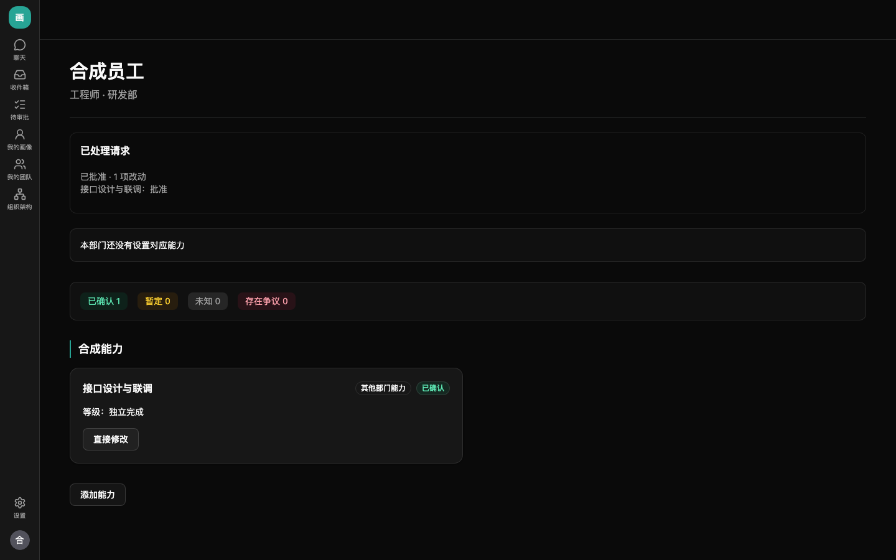
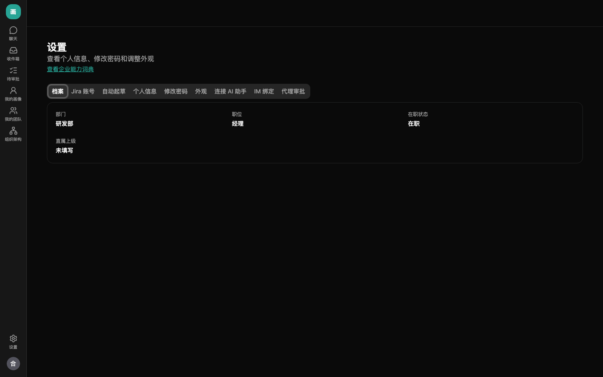
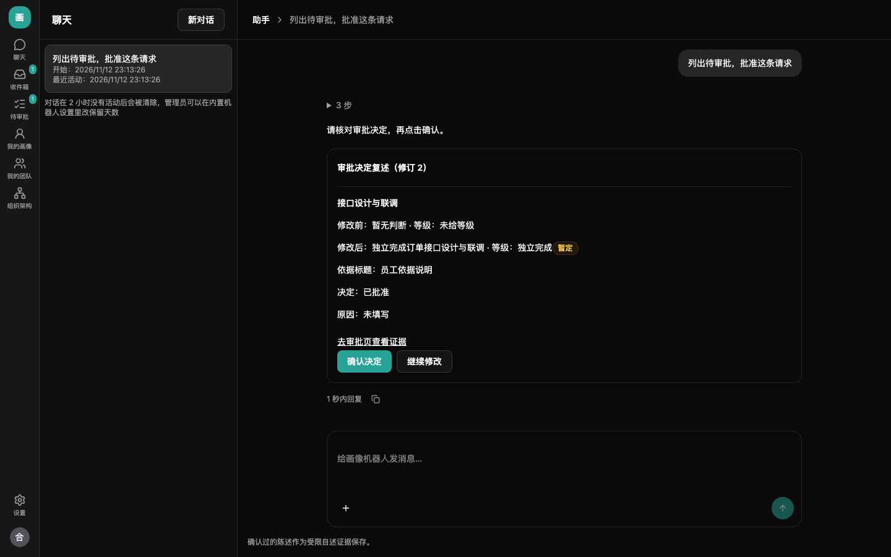

# 经理使用指南

文字已按 M4.5 更新；截图保留 M4.3 的界面，操作以文字说明为准。

登录后从「待审批」或收件箱进入请求。默认只显示当前由你处理的请求，部门范围包含获授权部门的全部下级部门。本人请求交上级部门经理或企业管理员，管理员与代理人也不能自批。

正式画像通过两种方式改变：经理批准请求（关闭经理确认的能力类别由本人确认后发布为「暂定」），或企业管理员、管辖经理直接修改他人画像并通知本人（E21）。系统自动起草仍先交本人过目；任何人不能批准自己的请求，也不能直接改自己的画像。

## 谁能看到我的画像

| 内容 | 谁能看到 |
| --- | --- |
| 正式画像的能力、等级、状态和陈述 | 本人、管辖经理（含获授权的上级部门经理）、企业管理员 |
| 依据说明和受限自述正文 | 本人和管辖经理；经理在网页审批页查看 |
| 未提交的草稿 | 只有本人 |

管辖范围包括获授权部门及全部下级部门，直属上级关系本身不授予部门权限。管理员身份本身不能读受限正文，兼任本人或管辖经理时按该身份授权。助手工具不提供下属的依据、受限正文和来源，需到网页审批页查看。查看不通知本人，也不留应用内查看记录；直接修改发布后通知本人。代理审批的临时读取例外见下文。

## 助手与我的团队

登录后进入三栏助手界面：图标导航、会话列表、对话区。导航包含聊天、收件箱、待审批、我的画像、我的团队和组织架构，底部是设置。模型不可用时，手工页面仍可用。本人画像编辑、材料上传及设置内容见[员工指南](employee-guide.md)。

「我的团队」列出服务器允许查看的人员，包含获授权部门及全部下级部门；「初始画像」列区分等待工作记录、等待起草、待本人过目、未生成判断、已处理等状态，手机上以卡片展示。「已处理」不等于已发布，仍需看审批状态。本人档案、Jira 账号、自动起草等移到设置，下属档案仍由管理员维护。

点击下属画像的能力名称先打开「能力详情（只读）」，展示完整陈述、等级、状态和北京时间的最近更新时间；依据和来源在网页审批时查看。需要改动时再点独立的「直接修改」。未定级的已发布判断显示陈述摘要，单列「未定级」，不计入「已确认」项数；结合陈述辨别否定和仅协助的含义。

词典缺少能力时，可在「添加能力」搜索无结果后「建议新增这项能力」，以你本人的身份建议，不会替下属修改画像。也可在网页或飞书助手中先核对建议内容并明确同意，交管理员处理；每人最多五条待处理。超时、附件复用、未保存输入保护和底部「退出登录」用法与[员工指南](employee-guide.md)一致。

## 直接修改下属画像

在下属能力卡点「直接修改」，填写陈述和等级，点「预览修改」，核对前后差异后点「确认直接发布」。也可以添加能力或撤回判断。发布无需本人同意，也不走待审批；新增和修改为已确认，撤回后为未知。员工会收到站内通知，已开启飞书推送且绑定时同时收到飞书消息。

在网页助手或飞书私聊可要求列出团队、查看下属画像并整理修改，核对确认卡后点「确认修改」才发布。不能直接改自己、其他企业、范围外或离职员工；同时具有管理员身份时，员工助手仍按管辖范围处理，全企业管理须用管理助手。不能改企业设置、能力词典或部门对应能力。

画像在预览后变化会提示刷新，读取新内容后重新修改。员工对直接修改有异议时重新编辑并提交审批；已有待审请求若引用的判断被取代，需要重提。直接修改不改写证据，改前改后和操作者留在审计中。

## 逐项决定

1. 查看改动前后、等级、陈述、证据、解释和不确定之处；请求中的长陈述可展开。「只有 Jira 来源」批准后仍为暂定，不能据 assignee 推断员工独立完成工作。
2. 每项选择批准、退回修改或拒绝。退回和拒绝必须写原因；可留整体意见。
3. 点「核对并提交」，检查复述的逐项决定，再点「确认提交决定」。内容变化时重新加载核对。

批准项在同一事务中生成新判断与画像版本。部分批准立即发布，退回项另建员工草稿。意见作为受限经理评价证据保留。员工可看原因与时间线、对拒绝项申诉，由管理员处理；争议标记不改写旧判断。

提交决定后，该请求会立即从待审批列表移除，可返回列表打开下一条；已处理或无权审批的详情会说明原因并提供返回入口。员工的提交预览和待审批请求中显示当前审批人及身份，代理人和原审批人可同时列出。

当前获授权审批人（含代理人、兜底管理员）在待审批期间可读请求引用的证据原文，以及这份请求主体员工与证据关联的判断，不扩大到其他员工。处理完毕或代理到期、撤销后恢复原权限；代理人只获得当前请求的临时读取权限，不因此获得对方整个部门的访问权。

## 代理审批

到「个人设置 → 代理审批」选择企业内有效成员，填写起止时间并保存。有效期间代理人与原审批人都能处理请求，先提交的决定生效；可随时撤销代理。代理不传递，也不能借代理批准自己的请求。

## 在网页助手审批

可以问「有什么要我批的」，说明逐项决定与原因，核对「审批决定复述」卡上的能力、等级和决定，点「确认决定」。点「去审批页查看证据」可读本次审批有权查看的依据，助手卡不展示受限正文。文字和模型输出不能代替确认；内容变化时重新读取。网页助手记来源为网页，批准与发布在同一事务内完成。

## 用 MCP 或 IM 审批

外部 AI 助手按[员工指南](employee-guide.md#通过外部-ai-助手更新画像)连接 MCP，企业管理员需先开启。经理工具包括 `list_pending_reviews`、`get_review`、`decide_review_items`、`get_team_overview`。让助手先列出改动及决定，明确同意后才提交；记录来源为 MCP 和客户端名称，只能按你当前的审批权操作。

飞书、企业微信、Telegram 需先绑定。私聊问「有什么要我批的」，说清每项决定及原因；核对审批复述卡片后点「确认决定」。文字回复和模型输出不能代替按钮。需要改动时点「继续修改」，卡片过长或需读受限原文时进入网页。记录来源为 IM 和平台名称。

三个 IM 平台目前仅以假服务验证，真实权限、可见范围及卡片显示由管理员试运行核实。

## 组织架构

从导航栏「组织架构」进入只读架构图，查看授权部门及下级的层级连线、经理和人数，可折叠下级部门。点部门查看汇报树，点人员查看上级链、本人和直接下属；「查看详情」进入员工详情，面包屑返回部门层级。汇报环显示「汇报线有循环」，大图可横向和纵向滚动。范围由服务器按当前授权计算。代审权限只临时用于当前请求，不会扩大架构图范围。
