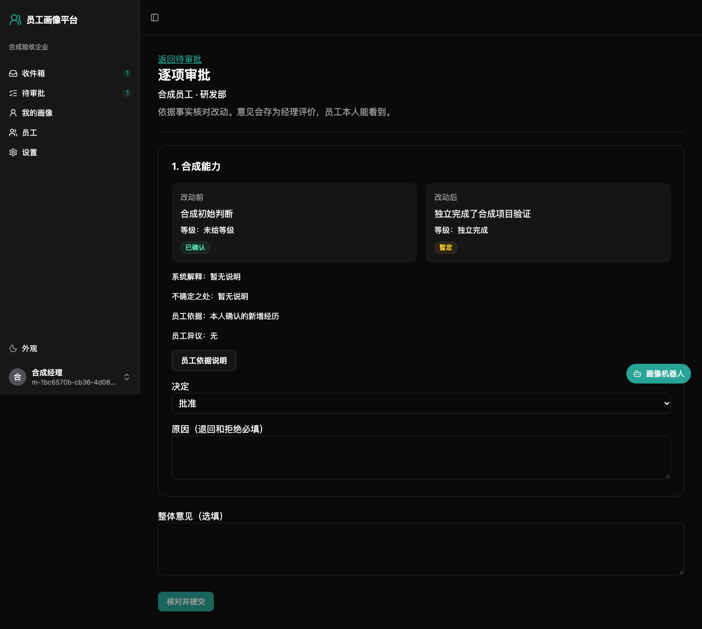

# 经理使用指南

登录后从「待审批」或收件箱进入请求。默认只显示当前由你处理的请求，部门范围包含获授权部门的全部下级部门。本人请求交上级部门经理或企业管理员，管理员与代理人也不能自批。

## 逐项决定

1. 查看改动前后、等级、证据、解释和不确定之处。「只有 Jira 来源」批准后仍为暂定，不能据 assignee 推断员工独立完成工作。
2. 每项选择批准、退回修改或拒绝。退回和拒绝必须写原因；可留整体意见。
3. 点「核对并提交」，检查复述的逐项决定，再点「确认提交决定」。内容变化时重新加载核对。

批准项在同一事务中生成新判断与画像版本。部分批准立即发布，退回项另建员工草稿。意见作为受限经理评价证据保留。员工可看原因与时间线、对拒绝项申诉，由管理员处理；争议标记不改写旧判断。

审批期间可读请求引用的证据原文。结束后恢复原权限，代理人只获得当前请求的临时读取权限，不因此获得对方整个部门的访问权。

## 代理审批

到「个人设置 → 代理审批」选择企业内有效成员，填写起止时间并保存。有效期间代理人与原审批人都能处理请求，先提交的决定生效；可随时撤销代理。代理不传递，也不能借代理批准自己的请求。

## 用 MCP 或 IM 审批

外部 AI 助手按[员工指南](employee-guide.md#通过外部-ai-助手更新画像)连接 MCP，企业管理员需先开启。经理工具包括 `list_pending_reviews`、`get_review`、`decide_review_items`、`get_team_overview`。让助手先列出改动及决定，明确同意后才提交；记录来源为 MCP 和客户端名称，只能按你当前的审批权操作。

飞书、企业微信、Telegram 需先绑定。私聊问「有什么要我批的」，说清每项决定及原因；核对审批复述卡片后点「确认决定」。文字回复和模型输出不能代替按钮。需要改动时点「继续修改」，卡片过长或需读受限原文时进入网页。记录来源为 IM 和平台名称。

三个 IM 平台目前仅以假服务验证，真实权限、可见范围及卡片显示由管理员试运行核实。
